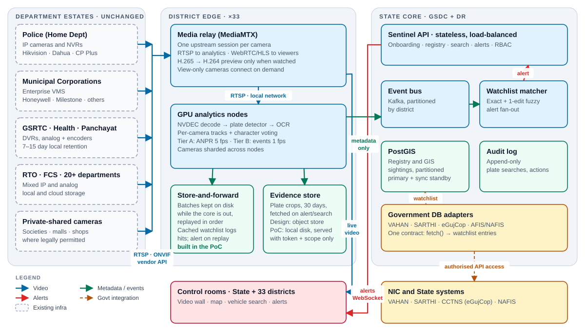
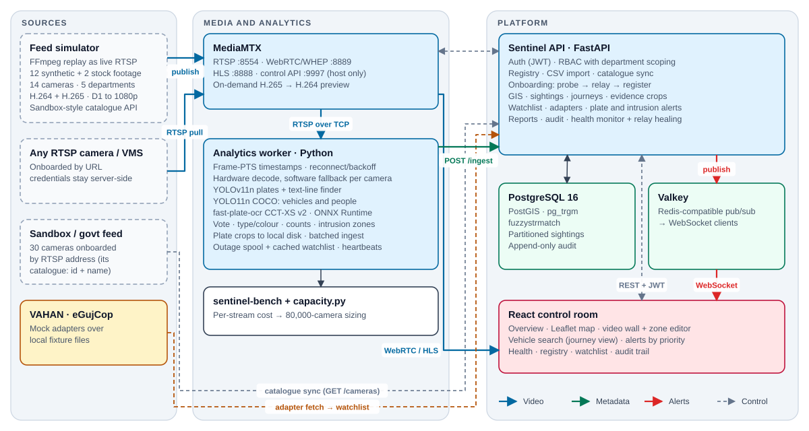
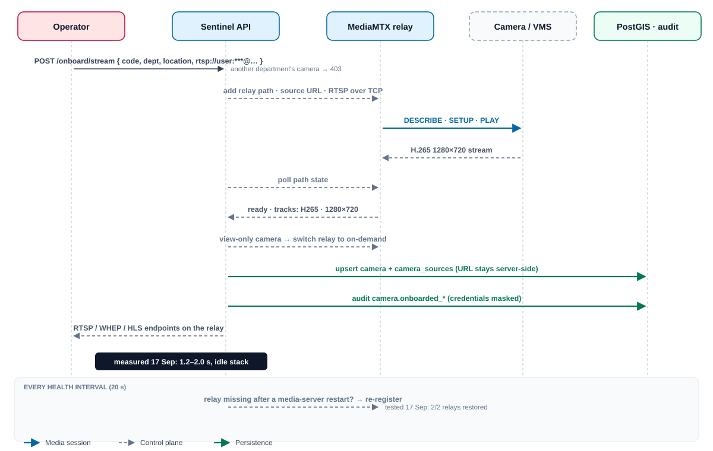
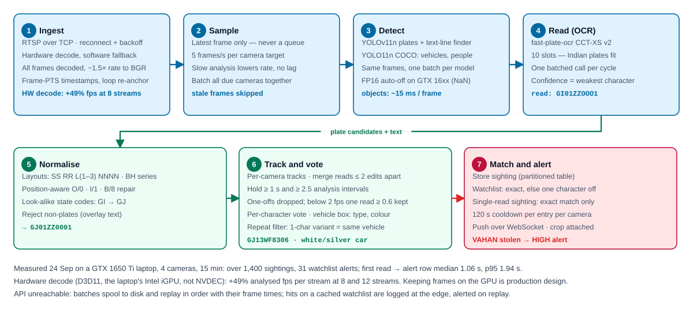
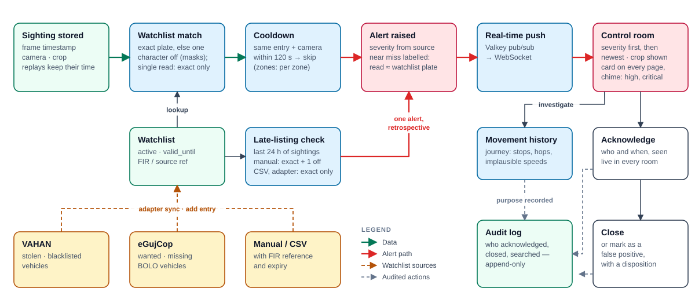
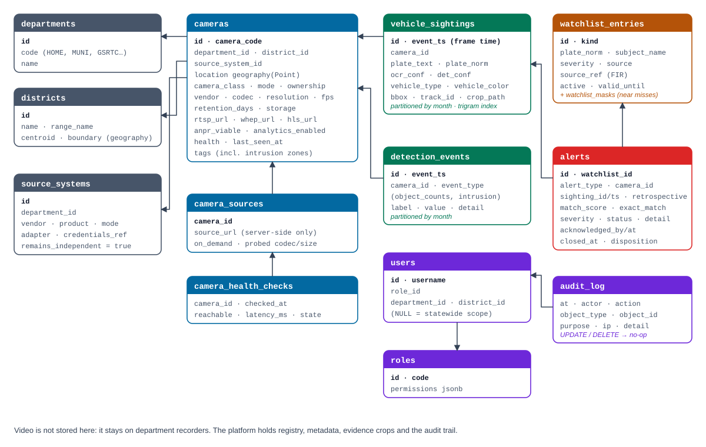
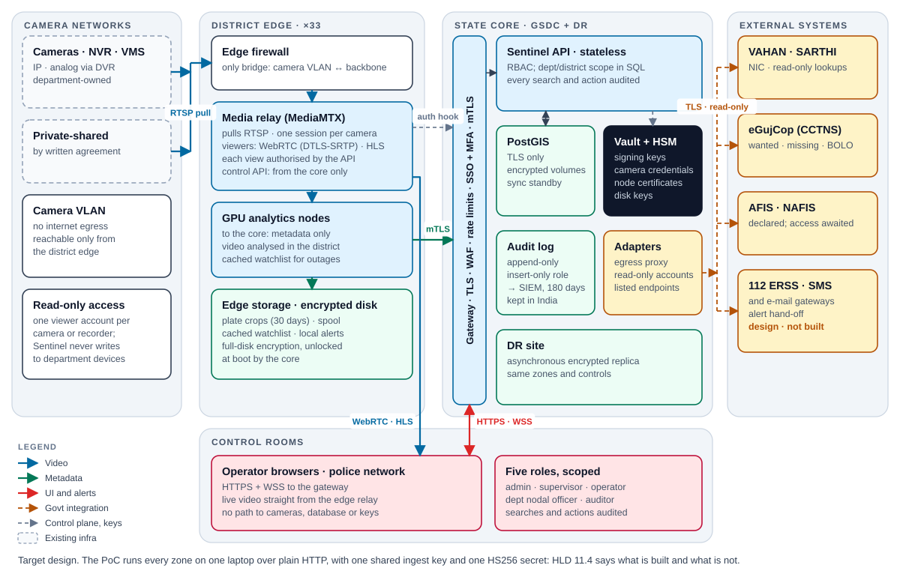
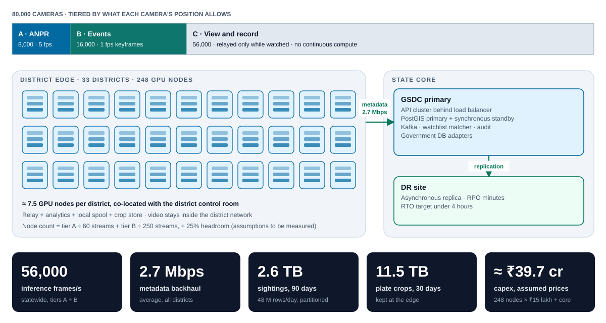

## 1. Summary

Gujarat has roughly 80,000 government cameras spread across 26 departments, bought from different
vendors, recorded on different NVRs and video-management systems, and kept for anywhere between 7
and 15 days. A vehicle seen on a police camera and again on a municipal camera five kilometres
away is, today, two unrelated recordings.

**Sentinel** joins them up without replacing any of it. It is **Model 2, unified viewing and selective analytics, built on Model 1, the registry and GIS
foundation every entry must include**:

- **Model 1 — Centralised registry and GIS** is the base layer: every camera, whatever its make or
  owner, is a row with a location, an owner, a stream endpoint, a health state and a statement of
  what analytics its position allows.
- **Model 2 — Unified viewing and metadata analytics** connects directly to department cameras and
  recorders over RTSP (ONVIF discovery planned), relays each stream once, and extracts vehicle
  movement metadata that is searchable statewide and matched in real time against watchlists fed by
  VAHAN and eGujCop (mock adapters that read local fixture files until live access is granted; their
  fields are modelled on the systems' published descriptions, not checked against the live interfaces).

The platform is **working software, not a design exercise**. Everything described as *implemented*
below runs today and is exercised by a 34-check end-to-end test, 23 negative security checks, 189 edge-case
checks, 111 control-room checks and 379 unit tests. Everything described as *at scale* is sized by a capacity model whose inputs are labelled
as measured or assumed.

| What is proven in the PoC | Measured |
|---|---|
| Onboard an unfamiliar RTSP feed by URL: probe, relay, register | 1.2–2.0 s end to end on an idle stack (17 Sep); ~4 s while the demo was recording |
| Mixed estate: H.264 + H.265, D1 to 1080p, 12–25 fps, 5 departments | 14 cameras live, 14/14 online |
| Plate reads and watchlist alerts on live streams (GTX 1650 Ti laptop, 4 cameras for 15 min, 24 Sep) | over 1,400 sightings and 31 watchlist alerts, 0 failed sends |
| First valid plate read to alert row, same host clock (the same 31 alerts) | median 1.06 s, p95 1.94 s (section 13) |
| Plate reads on stock traffic footage carrying synthetic plates (not Gujarat plates) | Close camera: 96.8% of reads exactly right and 91.2% of plates on screen ≥ 1 s read; wide camera: 90.2% and 21.7% (section 7.5; 10 minutes, 24 Sep) |
| The organisers' sandbox: 30 government cameras replaying recorded footage (25–26 Sep) | All 30 onboarded by RTSP, probe 1.0–2.2 s (median 1.1 s); 24 placed on the map from their names; counts on 30 cameras analysed in rotation, 31 intrusion alerts on two demo zones; 90 of 120 (75.0%) stored vehicle plates exact and 107 (89.2%) within one character, almost all on the 2 of 30 views where plates are readable, blind-checked against their crops by a team member (`bench/results/sandbox.md`, `sandbox_review.md`) |
| Counts and intrusion zones on every other camera at once, from keyframes only (the counts-only worker, 7 Oct; one laptop, no plate worker running) | 40 simulator streams at 0.78 counted frames per second per stream (median) on 2.46 CPU cores and 13% of the GPU; 50 streams saturate it. 7 sandbox cameras counted 14–34 frames a minute each while the sandbox dropped every session about every 45 s (section 5.4; `bench/results/counts_capacity.md`, `counts_sandbox.md`). Count accuracy and the two workers on one machine are unmeasured |
| Plate-reading quality per camera: every stored plate capture graded good, marginal or poor with its reasons; each camera given a tier and advice (section 5.3) | 8,635 captures graded; on the sandbox, CAM06 and CAM07 tier B (median plate 104 and 106 px across), the other 28 tier C. On the 120 blind-checked real plates the grade does not predict a right read; Sentinel's confidence does (section 7.5; `bench/results/capture_quality.md`) |
| Backhaul outage: API stopped for ~87 s while the worker ran | 21 sightings spooled, all replayed; alerts carried the original sighting time |
| Watchlist near-miss matching at 100,011 entries | ~1 ms per plate read, against 45–56 ms for the scan it replaced |
| Relays self-heal after a media-server restart | 2/2 restored within one 20 s cycle (17 Sep) |
| On-demand transcoding for browser previews | idle media CPU ~130% → ~23% of one core (17 Sep) |
| The core at statewide size: 80,000 cameras, 3.0 M sightings, 100,100 watchlist entries, one API process on the laptop | 706 sightings/s ingested and matched, against a modelled statewide average of 556/s; a floor, not a sizing (section 13) |
| RBAC with department scoping, append-only audit, masked credentials | covered by the end-to-end test and the security checks |

## 2. Design principles

1. **Integrate, don't replace.** Departments keep their cameras, recorders, retention and ownership.
   Sentinel opens one upstream session per camera and never writes to department systems.
2. **Video stays local; metadata moves.** Analytics runs next to the cameras. Only plate reads,
   events and alerts cross the state backbone — kilobits, not gigabits.
3. **Be honest about optics.** Most CCTV is wide-angle, and plates are unreadable on it. The
   registry records which cameras are ANPR-viable, and analytics is tiered accordingly.
4. **Vendor-neutral and open.** Open protocols (RTSP, WebRTC, HLS; ONVIF discovery planned) and
   open-source software, apart from the NVIDIA GPU driver and CUDA runtime (licence caveats in
   section 13). Vendor specifics live in adapters, never in the core.
5. **Accountable by construction.** Every plate search, every movement query with its stated purpose,
   and every onboarding, watchlist and alert action is audited;
   face recognition is deliberately absent (sections 7.4 and 11.3).

## 3. Why Model 2, on the Model 1 foundation

| Model | Decision | Reasoning |
|---|---|---|
| 1 — Registry + GIS | **Built — the mandatory foundation** | The portal flags Model 1 as mandatory: the common registry and GIS layer that Models 2, 3 and 4 build on. Nothing else works without a trustworthy inventory — where each camera is, who owns it, whether it is up, what it can see. |
| 2 — Unified viewing + selective analytics | **Built: the chosen model** | Delivers the live test case directly: onboarding, monitoring, plate tracking, watchlist alerts — without middleware and without touching department systems. The portal's own description of Model 2 covers every route and output we use: RTSP, ONVIF, vendor SDKs or APIs; ANPR metadata, event tagging, camera-wise indexing, searchable movement records, video walls and alerts, with no central storage of video. |
| 3 — VMS federation | **Not needed** | Model 3 puts a federation middleware between the platform and each VMS. Sentinel connects directly instead. A VMS that will not re-stream over RTSP connects through its vendor's SDK or API, which Model 2 allows: one adapter per vendor, recorded in the registry (`source_systems.adapter`); designed, not built. |
| 4 — Central VMS | **Not recommended now** | Re-ingesting and re-recording 80,000 streams centrally duplicates storage the departments already pay for (51.8 PB for 15 days), and needs 320 Gbps of sustained backbone at 4 Mbps per camera, 64 Gbps even for sub-streams only (capacity model, Plan for Scale §4.3). |
| 5 — Hybrid / innovative | **Not claimed** | Model 1 is every entry's mandatory foundation, so Model 1 with Model 2 is Model 2. What Sentinel adds beyond Model 2's list (vehicle and person counts, intrusion zones, route reconstruction with speed checks, store-and-forward at the edge) is analytics and deployment on Model 2's relayed streams, not a second integration architecture; Model 4's central recording is deliberately left out. |

On the submission form this is **Model 2 – Unified Viewing and Selective Analytics**, with Model 1 confirmed as
the foundation.

### 3.1 Architecture principles, point by point

The problem statement requires an "open, modular, scalable, secure, standards-based, and vendor-neutral"
architecture that avoids vendor lock-in and stays technology-agnostic. How each word is honoured:

| Principle | How Sentinel satisfies it |
|---|---|
| **Open** | Every component is open source on published protocols, with two licence caveats: react-leaflet, the map bindings, is under the Hippocratic License, which is not OSI-approved, and both detectors are AGPL-3.0, which puts obligations on a deployment (section 13; a replacement under a permissive licence is planned, not yet trained). The NVIDIA GPU driver and CUDA runtime are proprietary but free of charge. No proprietary SDK is required to run it. |
| **Modular** | Media relay, analytics workers, API, database and control room are separate processes with documented interfaces. Any one can be replaced without touching the others — the analytics worker, for instance, talks to the platform only through the `/ingest` endpoints (its camera list, the watchlist copy, sightings, events and heartbeats). |
| **Scalable** | Workers shard cameras by index; the API is stateless behind a load balancer; sightings are time-partitioned. Capacity is added by adding nodes, not by redesign. |
| **Secure** | RBAC with department scoping enforced in queries (reads and writes), append-only audit, credentials held server-side, evidence crops only behind a token, a permission and camera scope, the control plane bound to the host; per-path media authorisation at deployment. |
| **Standards-based** | RTSP, WebRTC/WHEP, HLS, SQL/PostGIS, OpenAPI, JWT; ONVIF Profile S/T for discovery is planned (section 5.1). No bespoke wire formats. |
| **Vendor-neutral** | No column, table or code path assumes a camera make or VMS. Vendor specifics live in adapters (`source_systems.adapter`, watchlist adapters). Checked with varied catalogue shapes in unit tests and with the simulator's RTSP streams (H.264 and H.265, published by FFmpeg); no vendor camera, NVR or VMS has been onboarded yet. |
| **No lock-in** | Cameras, recorders and storage stay with the departments. The platform holds metadata, which exports to CSV; the API is described by OpenAPI (`registry-api.json`). |
| **Technology-agnostic, future expansion** | New camera types arrive as URLs; new analytics attach to the same ingest contract; new government databases attach to the one adapter contract `fetch() → watchlist entries`. |

## 4. Architecture

**District edge (×33).** A media relay (MediaMTX) holds exactly one upstream session per camera and
fans it out: RTSP to the analytics nodes, WebRTC and HLS to viewers. GPU analytics nodes decode,
detect, read and track, then publish metadata, in two profiles: every frame on the cameras that read
plates, keyframes only on the rest (section 5.4). When the backhaul or the core is down, each analytics
node writes the batches it cannot send to a bounded spool on disk and replays them oldest first, with
their original frame times, once the core answers; meanwhile it matches plates against a cached copy
of the active vehicle watchlist and records any hit locally (section 8.1; built and tested in the
PoC). Plate crops stay at the edge and are fetched when an alert or a search needs them.

**State core (GSDC, with DR).** A stateless API tier, PostGIS for the registry and sightings, an
event bus partitioned by district, the watchlist matcher, the append-only audit log, and adapters to
government databases.

**Control rooms.** The state control room and district control rooms use the same web application:
map, video wall, vehicle search, alerts, health and reports, registry, watchlist and audit trail.

### 4.1 The proof of concept, as built

| Component | Technology | Responsibility |
|---|---|---|
| Feed simulator | FFmpeg, FastAPI | Replays clips as live RTSP cameras; mixed codecs and resolutions; sandbox-style catalogue API; outage injection |
| Media relay | MediaMTX | RTSP/WebRTC(WHEP)/HLS; relay paths created by the API; on-demand H.264 previews (H.265 cameras, and streams a browser cannot decode as they are, such as H.264 with B-frames or heavy packet loss; the transcoder waits for a clean keyframe on a lossy source) |
| Analytics worker | Python, OpenCV/FFmpeg, PyTorch (CUDA), ONNX Runtime | Ingest with hardware decode (software fallback per camera), plate detection, OCR, tracking and voting, vehicle/person detection and counts, vehicle type/colour, intrusion zones, batched ingest, store-and-forward spool, edge copy of the watchlist, heartbeats, sharding |
| Counts-only worker | Python, PyAV (FFmpeg), PyTorch (CUDA) | The tier B profile (section 5.4): keyframe-only decode of every other analytics camera at once, vehicle/person counts and intrusion zones from batched detection, heartbeats and its own spool; its own process beside the plate worker, never inside it |
| Sentinel API | FastAPI, asyncpg | Auth and RBAC, registry, onboarding and catalogue sync, GIS, sightings and journeys, watchlist and adapters, alert engine (watchlist and intrusion), evidence crops, plate review, plate-reading quality grades, reports, audit, health monitor |
| Database | PostgreSQL 16 + PostGIS, pg_trgm, fuzzystrmatch | Registry, geography, partitioned sightings and counts, watchlist with near-miss masks, alerts, ingest batch ids, plate reviews, capture grades, append-only audit |
| Event fan-out | Valkey (Redis protocol) | Pub/sub from API to WebSocket clients |
| Control room | React, Leaflet with react-leaflet, WebRTC, hls.js | All operator-facing screens |
| Benchmark and sizing | `sentinel-bench`, `capacity.py` | Measured per-stream cost; statewide sizing |

## 5. Camera, NVR and VMS integration

### 5.1 Integration modes

| Estate | How Sentinel connects | PoC status |
|---|---|---|
| IP camera with RTSP | Stream URL onboarded and relayed | **Implemented** |
| IP camera, ONVIF Profile S/T | Stream URI via ONVIF `GetStreamUri`, then relayed; main and sub profiles | URL onboarding implemented; ONVIF discovery planned |
| NVR / DVR (Hikvision, Dahua, CP Plus, …) | Per-channel RTSP from the recorder — no extra load on cameras | **Implemented** (it is an RTSP URL) |
| Analog cameras | Through the DVR's RTSP channel, or an IP encoder | **Implemented** (simulated D1 analog feeds) |
| Enterprise VMS (Milestone, Honeywell, …) | VMS RTSP re-streaming gateway, or the vendor's SDK or API: still a direct connection (Model 2), with no federation layer | Re-streaming implemented; SDK adapters planned per vendor |
| Camera offered over HLS only | The analytics worker reads the HLS URL when a camera has no RTSP URL; the browser plays HLS | **Implemented** |
| Hackathon sandbox / camera catalogues | Catalogue API sync: every camera registered in one call, after a dry-run preview (section 5.4) | **Implemented** |
| Bulk inventories from departments | CSV import with per-row validation and error report | **Implemented** |

### 5.2 Onboarding an unfamiliar feed

This is the flow for a feed handed over on the day. The operator pastes a URL; Sentinel probes it
through the relay, learns the codec and resolution from the stream itself, and registers the camera
with relay endpoints.

- **One upstream session.** However many operators and analytics workers read a camera, the camera
  or recorder serves one RTSP session — to the relay.
- **Credentials stay server-side.** Upstream URLs live in `camera_sources`; browsers and workers only
  ever see relay endpoints; audit records store the URL with the password masked. The onboarding form
  hides the pasted address while a screen is projected (show on demand), and a list of addresses goes in
  through the same path with `scripts/onboard_urls.py`, never through the registry's bulk CSV, which
  stores an address as given. A camera registered with a credentialed address anyway is shown to every
  reader with the credentials masked (`GET /cameras`, the CSV export; since 8 Oct).
- **On demand for view-only cameras.** A camera without analytics connects upstream only while
  someone watches it, which is what makes tier C (70% of the estate) nearly free.
- **H.265.** Browsers cannot be relied on to decode HEVC. The relay transcodes a 640p H.264 preview
  on demand; analytics always reads the original stream.
- **Self-healing.** Relay configuration is re-asserted every health cycle, so a media-server restart
  repairs itself.

### 5.3 Health monitoring and gap analysis

Every 20 seconds the health monitor records reachability, latency and byte flow per camera
(`online`, `degraded` when bytes stop arriving, `offline`) and publishes state changes live. An idle camera relayed
on demand is checked by a TCP connection to its server, one per host and port each round, however many cameras sit
behind it.
The gap-analysis report flags districts with no cameras, districts with cameras but no ANPR-viable
camera, and districts whose uptime falls below 70% (counting only cameras whose health is known), and ageing
infrastructure: AMCs or warranties expired or ending within 90 days, cameras installed `AGEING_YEARS` (7) or more
years ago, cameras under maintenance or faulty, and cameras with no installation year (decommissioned cameras are left
out). Each camera's maintenance state, note, installation year and AMC expiry are registry columns, edited from the
Registry page. Department reports show vendors, retention ranges and online counts per department.

**Plate-reading quality by camera** (built 26 Sep; Health & Reports page; `/reports/camera-quality`). Health says
whether a camera streams; this says whether its plates can be read. Every stored plate capture is measured from its
evidence crop and graded good, marginal or poor, with its reasons: size against published ANPR guidance (characters
at least 10 px tall, 20–60 px best; plates 100–150 px across, at least 75 px), blur, darkness, low contrast, glare,
two-line layout, and low reader confidence. The size cut-offs are the vendors' (Adaptive Recognition, Axis). The blur,
light and contrast cut-offs come from a damage test on our own stock-footage crops: each crop was blurred, darkened,
flattened or washed out step by step, and a cut-off is the point where fewer than 80% of our reader's reads survived
(`bench/results/quality_thresholds.md`); no sandbox crop or blind review was used to set them. Captures are graded at
ingest, and earlier sightings were backfilled (8,635 graded by 26 Sep 16:02). Each camera then gets:

- a tier: **A** reads plates (at least 60% of captures good and a median plate at least 100 px across, from 20 or
  more captures), **C** counts and viewing only (under 20% good, median characters under 10 px, or no plate read),
  **B** marginal in between;
- its captures, median plate width and character height, main issues, the blind-review exact rate where reviewed,
  and plates per 1,000 analysed frames;
- recommendations of three kinds: *camera* (zoom in or move closer, faster shutter, infrared, WDR off, re-aim),
  *model* (retrain the reader with reviewed plates) and *configuration* (mark it ANPR-viable, or use it for counts and
  viewing only).

Captures a reviewer marked as not a plate (a hoarding, a sign) are left out. The report holds counts, medians and
rates only, never plate text or a crop; it needs `reports.read` and is scoped to the user's department, like the other
reports (a security check, section 11.2). Vehicle Search shows each sighting's grade beside its crop. On the sandbox
(`bench/results/capture_quality.md`), CAM06 and CAM07 are tier B, with median plates of 104 and 106 px and 39% and 36%
of captures under size; CAM12 is C on one capture; the other 27 are C with no plate read (CAM05's 24 captures were
the hoarding). CAM12–CAM16, which the registry marks ANPR-viable, are flagged "marked ANPR-viable, but its captures do
not bear that out". The report's tiers describe what a camera's captures support; the statewide tiers of section 12
are what each camera is assigned to run, and the report is how those assignments are checked against real captures.
The grade describes the camera; on real plates it does not predict whether a given read is right (section 7.5).

### 5.4 Taking a government camera catalogue on the day

The live test case hands over about 50 feeds through a catalogue whose field names are not known in
advance. The tooling for that day, all built:

| Step | What happens |
|---|---|
| Preview | On the Registry page the operator pastes the catalogue URL, chooses what to analyse (cameras the catalogue marks ANPR, all, or none) and runs a dry run. Nothing is written; a table shows each camera as it would be registered: department, district, coordinates and where they came from, the analyse flag and every warning. |
| Mapping | Departments by code, by the words of a seeded department name, or by a hint (for example food and civil supplies → FCS, irrigation → NWR, roads and buildings → RNB); an unknown one falls back to the default department with a warning. Coordinates as lat/lon fields, a GeoJSON point, a list or a text pair, flat or nested, checked against a Gujarat bounding box: a reversed pair is swapped with a warning, a pair outside Gujarat is rejected rather than put on the map. Districts by name or spelling variant, otherwise from the nearest district centroid. Camera class, integration mode and storage type are read and validated. Every guess is kept in the camera's tags and the original record is stored beside it. |
| Sync | The same call without the dry run registers every camera and audits the sync. It is open to statewide users only, because a catalogue spans departments. |
| Analyse | A per-camera Analyse toggle in the Registry; the workers pick up the change when they restart. A plate worker takes at most `MAX_STREAMS` cameras (12 by default) and names the ones it leaves out in a warning; a `CAMERAS` list naming a camera that is not enabled for analytics is also warned. The counts-only worker takes every analytics camera not listed in `COUNTS_EXCLUDE` (the plate workers' cameras), up to `COUNTS_MAX_STREAMS` (60), and names the rest. |
| Checks | `scripts/smoke.py --skip-fleet` reports the three checks that assume the simulator's fleet as SKIP once government cameras are registered; the count stays 34. |

What the organisers have published about the sandbox (portal FAQ, read 24 Sep): about 50
live-simulated feeds, made from about 12 hours of recorded footage per camera from 30+ cameras in five
departments (Health, Police, GSRTC, Panchayat and Municipal Corporation), replayed by a Python
streaming middleware on a common timeline with one URL per camera. The registry is seeded with exactly
these five departments, and the mapping above recognises their names. A common timeline means a
vehicle passes each camera at a fixed moment of the replay, and a camera that is not being analysed at
that moment has no sighting of it: once the designated vehicle's number is given, as many cameras as
the hardware allows must be analysed at the same time, not in rotation.

What we met on 25 Sep. The sandbox catalogue (`cameras.json`) lists each camera by id and name only: no
department, district, coordinates or stream address. Its integrator's guide gives the RTSP address
(`rtsp://<email>:<password>@<host>:8554/stream/<id>`, TCP); its HLS answers browsers only (403 "browser
required" to FFmpeg), so the relay pulls RTSP. `scripts/onboard_sandbox.py` onboarded all 30 through the
URL-onboarding path (probe, on-demand relay, register): probe 1.0–2.2 s (median 1.1 s) per camera, H.264 and
H.265 from 960×576 to 2560×1440. Departments and positions are our reading of the names and pictures,
recorded as approximate in each camera's address; 6 names could not be placed and are registered
without a position, which the gap report lists. The laptop analyses 4 cameras at a time, so
`scripts/rotate_worker.py` rotates groups of 4 and logs which camera ran when. For 9 minutes of one
12-minute slot the sandbox refused our login (401) and then accepted it again; the worker kept retrying
and the second pass analysed those four cameras in full. A morning run on 8 cameras on 26 Sep met the
same: the server dropped connections from 07:10 and refused our login 07:26–07:40, then recovered, and
the worker reconnected on its own (its reconnect backoff has since changed, section 6). Two findings changed the
code: a camera whose hardware decoder opened at 0×0 now falls back to software at once (it used to wait
for 50 failed frames), and fixed text that passes as a plate is stored once, not again and again;
since 26 Sep numeric text that fits a plate only after two or more digits become letters is not stored
at all (section 7.1). Every camera's figures: `bench/results/sandbox.md`.

What the sandbox replays. Each camera plays one fixed clip, recorded in June 2026 at one time of day, in a loop:
its picture carries the recording's own date and time whatever our clock says (one camera always shows the same June
evening), and identical readings of the same plates recurred between our runs, hours apart; the loop length could not
be read from our runs (`bench/results/sandbox_loop.md`). So the time of a run says nothing about the light in
a camera's picture: our 25 Sep evening run and 26 Sep morning run replayed the same footage at different points of
each loop, and neither is a day or a night test (section 7.5).

**Two profiles, since 7 Oct.** The plate worker decodes every frame of its cameras: one laptop takes about
four at about 4.5 analysed frames per second each with object detection on (24 Sep), or eight at 2.9 with
it off (`bench/results/decode.md`). Reading plates needs that; counting does not. So a second worker, the
counts-only worker (`python -m sentinel_analytics.counts`; the tier B profile of section 12, which the
submission pack described as sized but not yet built), runs beside it as its own process and takes every
other analytics camera at once. It asks FFmpeg (through PyAV) to decode keyframes only, counts at most one
frame a second per camera, runs the vehicle and person detector in batches, watches the intrusion zones,
and writes the same count rows as the plate worker, each marked with how its camera was sampled (section
7.6). A camera whose keyframes are more than 4 s apart is switched to decoding every frame on the open
session, still counted at most once a second: otherwise it would be counted every 10–40 s and its zones
would miss short presences (the sandbox's CAM07, CAM17 and CAM18 keyframe every 10–15 s, the others every
1–2 s; `bench/results/counts_sandbox.md`). `COUNTS_EXCLUDE` names the plate workers' cameras, so no zone
alerts twice. Measured on 7 Oct on one laptop, no plate worker running, the relay's own CPU excluded: 40
simulator streams at 0.78 counted frames per second per stream (median) on 2.46 CPU cores and 13% of the
GPU; 50 saturates it, at 0.34 (`bench/results/counts_capacity.md`, section 13). On 7 sandbox cameras it
counted 14–34 frames a minute each over about 3 minutes in which the sandbox dropped every session at once
at least twice (`counts_sandbox.md`). Two things are unmeasured, and said so: the combined load of a plate
worker and the counts-only worker on one machine, and the accuracy of the counts (per-frame COCO detections
at about one frame a second, with no auto-rickshaw class and misses at night, section 7.6). At the finale
the plate worker reads the plate-readable cameras at full rate on one laptop and the counts-only worker
counts the other cameras, 30–40 of them, on a second (section 12): about 50 government feeds are then
onboarded, viewable and all analysed at once, not in rotation.

## 6. Stream ingestion

| Concern | Approach |
|---|---|
| Transport | RTSP over TCP (sandbox rule; avoids UDP loss on constrained links); HLS for a camera listed with an HLS URL only. A worker opens rtsp, rtsps, http and https addresses only: a registry stream field holding any other scheme is not handed to FFmpeg (8 Oct, section 11.4) |
| Failure | Reconnect with exponential backoff from 2 s, capped at 30 s (sandbox guidance). The backoff starts again from 2 s only after 60 s of healthy streaming: it used to reset on the first frame, so a source that dropped each session a few seconds in was retried every 2–5 s (the sandbox dropped our sessions three times on 25–26 Sep and twice refused our login); now it backs off to 30 s (2 unit tests). On 7 Oct the sandbox dropped every session about every 45 s (`bench/results/counts_sandbox.md`). The health monitor marks a stalled stream `degraded` |
| Time | Event time is the **frame timestamp** (stream PTS anchored to wall clock), never arrival time |
| Replays and loop points | A PTS jump backwards or a gap over 5 s re-anchors the clock |
| Mixed codecs | FFmpeg decodes H.264 and H.265 at any resolution; nothing is assumed per camera |
| Decode | Hardware decode by default (`HW_DECODE=auto`: OpenCV asks for any hardware decoder, D3D11 on Windows). On the PoC laptop the decoder OpenCV opens is the Intel UHD integrated GPU's, not the GTX 1650 Ti's NVDEC (checked 24 Sep with the Windows GPU-engine counters, which put the decode load on the Intel adapter, while `nvidia-smi` showed the NVIDIA decoder at 0%). A camera that will not open or yields no frame that way falls back to software decode on its own, with a warning. Measured A/B in section 13. The counts-only worker decodes through PyAV (FFmpeg) with the decoder told to skip every non-key frame: on 7 Oct, 14 simulator streams (H.264 and H.265, 576p to 1080p) cost 0.52 CPU cores keyframes-only against 2.53 cores decoding every frame (re-measured 8 Oct by `bench/keyframe_decode.py`: 0.47 against 2.57 cores, `bench/results/keyframe_decode.md`; the stream table is `bench/results/counts_capacity.md`) |
| CPU budget | Plate worker: every frame is decoded (inter-frame codecs need it), but only ~1.5× the analysis rate is converted to images. Counts-only worker: keyframes only, which a decoder produces without the frames before them, scaled to 960 px wide while converting; a camera whose keyframes are more than 4 s apart is decoded in full (section 5.4) |
| Back-pressure | Latest-frame semantics: a slow analyser lowers its rate, it never builds a queue or falls behind live |
| Scale-out | Workers take cameras by `WORKER_INDEX` of `WORKER_COUNT`, or an explicit `CAMERAS` list; capacity is added by adding workers. `MAX_STREAMS` caps one worker, and the cameras over the cap are named in a warning. A worker on another machine sets `RELAY_HOST` (7 Oct): the registry stores relay addresses as `rtsp://localhost:8554/<code>`, and the worker rewrites `localhost` to the relay machine's address (the two-machine deployment of section 12; `.env.b.example`) |
| Backhaul outage | Batches the API cannot take are spooled to disk and replayed in order (section 8.1) |

## 7. AI approach

### 7.1 ANPR pipeline

**Detection.** A YOLOv11n licence-plate detector runs on the GPU, batched across all cameras due in
a cycle. It is unioned with a classical text-line finder (black-hat morphology), which localises
dark characters on bright plates on footage the detector was never trained on. Every candidate must
still survive OCR and Indian-plate validation, so the looser candidate set costs OCR time, not
precision. FP16 is disabled automatically on GTX 16-series cards, which return NaN boxes in half
precision.

**Recognition.** fast-plate-ocr's CCT-XS v2 global model (10 character slots, so 10-character Indian
plates fit), batched across every crop in a cycle on the CPU. Confidence is the *weakest character's*
probability, because one wrong character is what breaks a watchlist match. A sighting whose reads all
agree (three or more) stores its confidence raised to between 0.9 and 0.99 for that agreement, so the stored
confidence is a track score, not always the raw OCR probability. Since 8 Oct each sighting also stores how
many reads stood behind it (`reads`) and how far the vote agreed (`agreement`, the weakest position's winning
share; 1.0 for a single read), so an operator can tell a one-read 0.6 from a three-read 0.95 (section 7.5).

**Indian plate normalisation.** Reads are parsed against the standard layout (`SS RR L{1–3} NNNN`)
and the BH series. Confusions are repaired by *position*: a state code is letters, an RTO code and the
running number are digits, so `O`/`0`, `I`/`1`, `B`/`8` are resolved correctly in each place. Invalid
state codes are repaired by look-alike substitution (`GI01…` → `GJ01…`). Text that is not a plate —
DVR timestamp overlays, camera IDs — is rejected, and so is text that fits the layout only after two or
more of its digits are turned into letters (*Not a plate*, below).

**Tracking and voting.** A vehicle crossing a camera produces many reads. Reads within two edits of a
live track join it. A new track is held until three reads have arrived or its confirmation window
closes, then emits once. The window runs on the wall clock, not on frame time (when decoding falls
behind, frame times lag and a frame-time window would close before a second read could arrive), and
stretches with the camera's achieved analysis rate: at least one second and at least 2.5 analysis
intervals. The stored plate is a per-character, confidence-weighted vote across the track's reads of
the most common length, so a random single-frame error is outvoted; if the vote is not a valid Indian
plate, the best single read is stored instead. The evidence crop is the most confident read.

A track seen only once is normally discarded as a likely mis-detection. On a camera analysed below
2 frames per second a vehicle may only ever be analysed once, so there a single read with OCR
confidence of at least 0.6 is accepted, counted and logged; the API raises an alert on such a
single-read sighting only when it matches a watchlist plate exactly. Unit tests reproduce the failure
this fixes (no sightings at all at 0.8, 0.5 or 0.3 analysed frames per second, or with 1.5 s of frame
lag) and pass.

After emission the same plate on the same camera is suppressed for 8 seconds, extended while it stays
in view. A plate one character away from a plate the camera emitted within that window counts as the
same vehicle; without that, one vehicle read two ways became two phantom vehicles. The trade-off: an
early misread can become the stored plate for that pass.

**Fixed text.** On the organisers' sandbox a phone number on a hoarding, "75750 83008", passes the
plate rules as `TS75OB3008` and was stored 23 times in 25 minutes before this rule existed, and
once in the hour and a half after it. A vehicle does not show
the same text at the same spot of the picture again minutes later; fixed text does, and so does a parked
vehicle. So a sighting whose text is similar to one stored at the same place (boxes overlapping) within
10 minutes is not stored, and similar text there stays muted until unread for 30 minutes
(`static_text.py`, 7 unit tests built on the hoarding's own reads). "Similar" means a difflib ratio of 0.8,
about one character in ten: the hoarding's two reads score 0.84, while two different plates of one RTO series
pass that bar 0.2% of the time (at the first setting, 0.6, it was 30%, and one CAM06 plate was dropped on 25 Sep). Different vehicles stopping at one spot
(a toll booth, a stop line) carry different plates and are all stored. The simulator loops each vehicle
past the same spot every 60 s, so simulator runs turn the rule off (`STATIC_TEXT_WINDOW_S=0`).

**Not a plate.** The fixed-text rule still stores the first sighting of a piece of text: the hoarding
was stored 24 times in all. Its phone number fits a plate layout only because the position-aware repair
turns four of its digits into letters. So since 26 Sep a read is dropped when two or more of its letters
had to be made from digits to fit a plate layout (state code, series and BH letters counted together);
one such letter is a common misread and is kept. The rule runs on each read after the confidence and
plate-layout checks and before the tracker (`MAX_LETTERS_FROM_DIGITS`, default 1; a large value turns it
off), and the worker logs per camera how many reads it dropped, as counts only. Its adoption gates were
written down before it was built into the product (`bench/plate_gate_gates.md`) and all passed on 26 Sep
(`bench/results/plate_gate_confirm.md`, `plate_gate.md`):

| Check | Result |
|---|---|
| The hoarding caught | 23 of 23 frozen crops; 24 of 24 stored not-a-plate sightings |
| Real plates lost, organisers' sandbox | 0 of 25 exact reads (frozen set); 0 of the 92 stored plates our AI assistant labelled exact |
| Plates lost, our own feed (synthetic plates on stock footage) | 4 of 5,307 exact reads; 0 of 128 vehicles |
| Plates lost, held-out synthetic plates (GJ, other states, BH) | 1 of 1,723 |
| Fresh synthetic non-plate text (phone numbers, timestamps, overlays, shop and truck text; seeds never run before) | 4 of the 126 crops that pass today's checks still pass (3.2%) |
| Worker with the rule on, 10 minutes on four cameras (a wiring check, not a measure of the rule) | 97.1% of stock-footage sightings exact (669 of 689); 63 of 68 plates captured on AMD-TRAF-002 |

With the rule, the 24 hoarding sightings would not have been stored and no real sandbox plate would have
been lost. Its limits: the real non-plate evidence is one hoarding (3 texts, one camera), and the rule was
chosen after seeing them; the sandbox labels it was tested on are our AI assistant's, not blind; and it stops numeric text
being taken for a plate, not signage made of letters. On the two sandbox cameras that read plates it
dropped no read in 135 minutes of the 26 Sep capture (CAM06 81 sightings stored, CAM07 30; two fixed-text
drops on CAM06; `bench/results/plate_gate_live.md`): the hoarding is in CAM06's view, so that is the rule
holding against it, not a false-positive rate on text in general. A learned plate / not-a-plate classifier,
with its own gates written in advance (Stage B in the same file), was not built before the finale and
stays on the roadmap (section 14).

The vote and the best single read were compared on the same tracks (`bench/results/plate_choice.md`,
24 Sep, two 5-minute runs on four cameras): a statistical tie overall, 84.2% against 84.4% of tracks
exactly right with hardware decode (2,502 tracks) and 83.6% against 84.4% with software decode (2,389
tracks). The vote was ahead on the wide stock-footage camera (94.6–96.0% against 93.4–94.0%), so the
worker keeps the vote. The overall figures are pulled down by a synthetic camera whose drawn plates
read at about 63% under either rule.

**Tiered analytics.** At scale, cameras flagged ANPR-viable run the plate pipeline (tier A, 5 fps)
and tier B cameras get event analytics only. Since 7 Oct both profiles exist: the plate worker, which
decodes every frame and runs the plate path and the object detector, and the counts-only worker, which
decodes keyframes only and runs counts and zones on many cameras at once (section 5.4; Plan for Scale
§6.1). A camera marked for analytics is counted by the counts-only worker unless a plate worker is given
it (`CAMERAS` on the plate worker, the same codes in `COUNTS_EXCLUDE`); that choice is made per
deployment, not yet from the `anpr_viable` flag. A plate worker on a wide camera produces vehicle and
person counts and reads only the few plates large enough (the wide stock camera read 21.7% of the
plates on screen for a second or more, section 7.5), and the reads it makes are stored. Tier C cameras
are relayed and recorded, not analysed.

### 7.2 Tracking across the network

Cross-camera tracking is **plate identity plus geography plus time**: the movement query returns every
sighting of a registration number, including 1-edit OCR near-misses, ordered by frame time with camera
locations. The search page shows it as a journey:

- **Visits.** Consecutive reads at the same camera no more than five minutes apart are one visit (a
  stop), with its first time, how long the vehicle stayed and its best evidence crop. Stops are
  numbered on the map in order.
- **Hops.** Between consecutive exactly-read visits at different cameras, the hop carries the
  distance between the two cameras, the travel time and the average speed. The distance is a
  straight line between cameras and the speed is an average over the leg, not a measured speed; the
  page says so.
- **Implausible speed.** A hop of at least 1 km at more than 150 km/h is flagged: two vehicles
  carrying the same plate (a cloned plate) or a misread is more likely than the speed. Below 1 km,
  camera placement error dominates, so short hops are not flagged.
- **Near misses.** A visit made only of one-character-off reads is kept, marked as a possible misread,
  and never used for a speed.

Every read stays available as a list and a CSV export. Where plates are unreadable, appearance-based
vehicle re-identification is on the roadmap (section 14); it is deliberately not claimed as delivered.

### 7.3 Object, person and event analytics

The problem statement asks the HLD to cover object detection, person and vehicle tracking and other
analytics alongside ANPR. ANPR is the one analytic the portal calls mandatory. Vehicle and person
detection now run beside it, on the same frames and into the same storage, and intrusion zones are
built on their boxes; the rest are stated as design with an honest status:

| Analytic | Status | Approach |
|---|---|---|
| **ANPR** (plate detection, OCR, normalisation, voting) | **Implemented and measured** | Section 7.1 |
| **Vehicle and person detection, counting** | **Implemented and measured** | A second detector (stock YOLO11n, COCO classes person, bicycle, car, motorcycle, bus, truck) runs on the frames the plate path already pulled, so it never takes frames from ANPR. Each camera writes one `detection_events` row per minute: frames analysed, and per class the detections and the most seen in one frame. Shown as *in view* (average per analysed frame) and *peak*, on the Overview, the Health page and in the detection report. Since 7 Oct the counts-only worker writes the same rows from keyframes on the cameras no plate worker takes (section 5.4). Section 7.6. |
| **Vehicle type and colour on sightings** | **Implemented and measured** | The plate detector is single-class and cannot say what a plate is mounted on, so each plate is bound to the vehicle box that contains it. Type is voted across the vehicle's reads; colour is a heuristic over its body panels. Both land in `vehicle_sightings.vehicle_type` / `vehicle_color`, and either stays NULL when unsure. Section 7.6. |
| **Intrusion detection** | **Implemented; checked on one demo zone** | Polygons drawn per camera on the live video, with trigger classes, minimum dwell, armed hours and severity. Either worker tests the object detector's boxes against them (the plate worker on its cameras, the counts-only worker on the rest); an occupancy becomes one `intrusion` alert carrying the zone, classes, count and dwell, never a box or image. Section 7.7. |
| **Queue length, crowd density, loitering, wrong-way** | Roadmap | Build on the same per-frame boxes and the zone geometry that now exists per camera: density from the counts; loitering and wrong-way also need track histories. Emitted as `detection_events` and raised through the existing alert path, as intrusion is. |
| **Cross-camera vehicle tracking** | Implemented via plate identity | Section 7.2: plate + geography + time. Appearance-based re-identification for unreadable plates is roadmap. |
| **Facial recognition (FRS)** | **Deliberately not implemented** | See below. |

### 7.4 Face recognition — a deliberate omission

The HLD requirement lists FRS among the analytics to describe, so we describe it and our position.

Sentinel does not perform facial recognition. Detecting that a person is present is not recognising
who they are: Sentinel counts people (section 7.6) and notices a person inside an intrusion zone
(section 7.7), and stores no box, image or track of any person.
Wide-area biometric matching of people who are not
suspects is hard to justify under the DPDP Act's purpose limitation and data minimisation, published
accuracy varies across demographics, and a false biometric match in a policing context carries
consequences a false plate read does not. Vehicle-based tracking answers the operational questions in
the problem statement — stolen and blacklisted vehicles, BOLO, movement history — and wanted- and
missing-person watchlist entries are operationalised through their associated vehicles.

If the department requires FRS, the pipeline accommodates it without redesign: it is another detector
in the same batched inference step, writing to `detection_events` and matching against a gallery
through the existing watchlist and alert path. What it would need first is a lawful basis, a retention
and review policy, an accuracy and bias evaluation on Gujarat footage, and an audit regime at least as
strict as the one already in place for plate searches. The `ENABLE_FACE_RECOGNITION` flag exists so the
choice is explicit in configuration rather than buried in code. See `docs/privacy-dpdp.md`.

### 7.5 Accuracy — what we know and what we don't

**Real Gujarat plates, checked blind by a person (the organisers' sandbox, our 25–26 Sep runs).** On 26 Sep
(12:28–13:02 IST) a team member checked 144 of the 145 real sightings Sentinel stored from the sandbox on
the plate review page (section 7.8), signed in as the administrator account. The check is blind: the page
shows only the evidence crop, the reviewer types the plate, and the server compares that reading with the
stored read. 24 were a hoarding's phone number (a reading with no letters is graded "not a plate"). Of
the 120 vehicle plates, **90 were exactly right (75.0%)** and 107 within one character (89.2%); 13 were
wrong, and none was marked unreadable (`bench/results/sandbox_review.md`). By camera: CAM06 71 of 92,
CAM07 19 of 27, CAM12 0 of 1. The 25 Sep evening run (20:07–23:48 on our clock, all 30 cameras) gave 54 of
75 (72.0%), 68 within one character; the government-feed video and report cover that run, and were made
before any review. The 26 Sep morning run (06:51–07:58, 8 cameras) gave 36 of 45 (80.0%)
(`bench/results/sandbox_daynight.md`). Both runs replayed the same looping footage (section 5.4), so the split is
by run, not by day and night.

Sentinel's own confidence separates the good reads from the doubtful ones:

| OCR confidence | Plates | Exact | Within one character |
|---|---|---|---|
| 0.9 or above | 81 | 69 (85.2%) | 79 (97.5%) |
| 0.7–0.9 | 20 | 13 (65.0%) | 14 (70.0%) |
| 0.5–0.7 | 18 | 8 (44.4%) | 14 (77.8%) |
| 0.35–0.5 | 1 | 0 | 0 |

That table is the basis of the confidence marking built on 8 Oct (change G3 of `bench/pipeline_gates.md`,
the one finale pipeline change adopted; API setting `CONFIDENCE_MARKING`, on by default, `false` restores
the 26 Sep behaviour). A stored read below 0.9, compared as the review page compares it (the REAL column
rounded to 3 decimals, so a read stored at exactly 0.9 is not marked), is marked "check the crop" in the
alert list, the live alert card, Vehicle Search and the journey view, and a watchlist alert raised on a
one-character match is marked whatever its confidence; the Plate review page has a "Below 0.9, unchecked"
filter so those reads are checked first. Nothing is suppressed and no alert rule changes: a mark costs the
operator one look at the evidence crop. The band is the review page's, fixed on 26 Sep, and on these 120
plates it separates 69 of 81 exact from 21 of 39. Its gate (`bench/results/g3_wiring.md`, 8 Oct): the unit
tests and the live checks passed with marking off and on (a 0.85 read marked, a 0.90 read stored and read
back unmarked, a one-character alert marked, `reads` and `agreement` written, the same alert count either
way); in a wiring pair of 10-minute windows on four simulator cameras, the API marked 161 of 748 scored
stock-footage sightings, exactly the number `scripts/anpr_eval.py` counts below 0.9, with the exact rate
unchanged (97.9% off, 97.2% on) and the alert latency no worse. That pair ran on a laptop also running the
control room's development server, at 9–9.5 analysed frames per second over the four cameras, so its
latencies are not the figure of section 13. The leg that would test the band on fresh real plates was not
run, because `sandbox-fresh-v1` was never frozen: no claim is made that confidence separates right from
wrong reads beyond the 120 blind-checked plates above. The marking ships as a review aid, not as an
accuracy change.

**How far the check can be trusted.** We tested the method where the true plates are known. On 226 blind
reviews of our own cameras (synthetic plates, and plates painted onto stock footage) the reviewer was
right 222 times (98.2%); of the 41 reviews the page graded one character off or wrong, the truth
confirmed Sentinel's error in 37 and the reviewer's typing slip in 4. On the stock clip AMD-TRAF-002 the
blind check found Sentinel right on 96.7%, matching the automated ground-truth figure of 96.8%
(`bench/results/review_truth.md`, `bench/review_truth.py`). One person checked the sandbox plates; none
has been checked by a second yet.

**Why the 30 misses missed** (`bench/results/blind_errors.md`). Our AI assistant looked at each missed crop with both
readings in view and judged whose reading the crop supports: Sentinel's stored read was wrong on 13, the reviewer's
reading on 13 (typing slips 5, a look-alike typed where the plate format fixes a letter or a digit 4, misreads 4; 10
of the 13 are not valid registrations as typed, 12 of all 30), both on 1, and on 3 the crop cannot say. Its own blind re-read of the
crops, shuffled among hits with no reading shown, sided with the stored read on all 13 reviewer-side misses and against
it on all 14 where Sentinel's read was wrong. That is an AI's judgement, not a person's, so it changes nothing: the
quoted figure stays 90 of 120, and only a second blind reviewer can move it (section 14). Where Sentinel was wrong, the
causes were a dropped character (a ten-character plate stored as nine) 5, a letter read as a similar letter 3, a
digit misread 3, the vote choosing a short read 1, and the plate box stopping short of the plate's end 1 (the plate
where both were wrong, a digit misread). Re-reading the stored crop alone repeats 13 of those 14 misreads, so they are
the reader model's, not the vote's. Sentinel's own confidence is the strongest sign of a misread (AUC 0.84 on the
misses where Sentinel was wrong, 0.72 on all 30); plate size, blur and brightness barely separate misses from hits
(AUC 0.46–0.61).

**Reading changes tried without training** (`bench/results/ocr_fix_trials.md`). 25 changes to how a crop is read
(test-time augmentation with three ways of combining the views, contrast enhancement, 9 other fast-plate-ocr models
alone and in two ensembles, reading a two-line plate as two halves, upscaling) were fixed, with the rule for a gain,
before any was scored on the 120 blind-checked crops. None met the rule on real plates. The one with the most net
fixes, eight augmented views combined per character, read 93 of 120 exact against the shipped reader's 88 on the same
single crops (6 fixed, 1 broken; not significant once corrected for 25 trials), broke two-line plates on our own feed,
and cost about ten times the CPU. Every other available model read fewer plates exactly (the next best 53 of 120): the
shipped reader is the best of those available. The Indian-format fine-tune `ft1` was then trained and scored on the
frozen sets (`bench/results/ocr_ft1.md`, 26 Sep): on the 120 blind-checked real plates it read 89 exact against the
shipped reader's 88 on the same crops (8 fixed, 7 broken; p = 1.0), and 66 against 69 among the 81 stored at
confidence 0.9 or above. It passed its gates as non-inferior, showed no gain on real plates, and is not adopted: the
shipped reader runs at the finale. (The stored sightings, voted over several frames, were 90 of 120; the single-crop
re-read is 88.)

**Does the capture grade predict a right read?** Not on real plates. On the 120 blind-checked sandbox plates, captures
graded good (section 5.3) were exact 53 of 66 (80.3%), marginal 29 of 44 (65.9%) and poor 8 of 10 (80.0%), with
overlapping intervals; the one reason whose captures were read clearly worse was the reader's own low confidence (1 of
6 exact) (`bench/results/capture_quality.md`). On our stock-footage clips, with thousands of sightings, the grades do
order the error rate (good 99.1%, marginal 97.5%, poor 92.6% exact against the painted plates), but those are the clips
the blur and light cut-offs were set on, so that is not an independent test, and a plate too small or blurred to read
leaves no sighting to grade. So the grade describes a camera's captures and drives the advice in section 5.3; it does
not say whether a given read is right. Sentinel's confidence does that better (above).

**An earlier, optimistic figure.** Before the review page existed, our AI coding assistant compared each
stored read with its crop, with the stored read in view, so not blind and not a person: 92 of 107
(86.0%) exact, after leaving 14 crops out as unreadable (`bench/results/sandbox_eye.md`; 55 of 66 in
the evening run, 37 of 41 in the morning run). On the 106 crops it judged readable the blind reviewer found 80 exact against its
92. The AI figure was optimistic, whether from anchoring on the stored read or because the reviewer
misread blurred crops; a second blind reviewer would settle the 12 disagreements. We quote the blind
figure. The AI check's 66 evening-run plates belong to about 53 vehicles: the replay loops (the same
plates recurred between the run's analysis windows, `bench/results/sandbox_loop.md`), and twice one vehicle was stored as two sightings with two misreads.

It is precision only: the live replay cannot be labelled frame by frame, so how many plates went unread
is unknown.

On the same 8 cameras the two runs stored 4.6 (evening) and 4.1 (morning) plates per 1,000 analysed
frames, and the toll-plaza camera (CAM12) stored none in the morning run's 1,925 frames: two samples of the
same looping footage, so the difference is where each camera's loop was, not the light
(`bench/results/sandbox_daynight.md`). Most sandbox cameras are wide overview and red-light views, several
of them recorded at night, where the plate detector found few plates and those it found were too small or
blurred to read (`bench/results/sandbox_plates.md`, `sandbox_plates_day.md`); the reads came from the
cameras whose view and light allow it. Another 23 stored sightings were a
hoarding's phone number read as a plate, before the fixed-text rule (section 7.1), and one more after
it; the not-a-plate rule (section 7.1) would have stored none of the 24. Every sighting stores
OCR and detection confidence (a track score when three or more reads agree, section 7.1), the evidence
crop and the frame timestamp, so this check is cheap to repeat per camera class.

What has been measured is the pipeline on real traffic carrying synthetic plates. Two simulated
cameras replay Pexels stock footage (filmed on a Mumbai road, whose signs are visible in the frame; the
Ahmedabad camera names and positions are simulated) in which every plate the painter found was
replaced by a synthetic Gujarat registration in a clean font, so ground truth is known. Measured with
the current worker (`bench/results/anpr_eval_current.md`, `scripts/anpr_eval.py`):

| Camera (stock footage, synthetic plates) | Sightings | Exactly right | Within one character | Plates on screen ≥ 1 s read at least once |
|---|---|---|---|---|
| AMD-TRAF-002: close, ANPR-style view, H.265 | 681 | 96.8% (659) | 97.4% | 91.2% (62 of 68) |
| AMD-TRAF-001: wide view, not ANPR-viable, H.264 | 193 | 90.2% (174) | 96.9% | 21.7% (28 of 129) |

Conditions: 24 Sep 2026, 01:29–01:39 IST (10 minutes); four cameras on one worker on the GTX 1650 Ti
laptop, hardware decode and object detection on, about 4.5 analysed frames per second per camera; the
stored plate is the character vote (section 7.1). The clips are 60 seconds long, re-encoded at up to
4 Mbps and looped, so precision is over repeated passes of the same painted plates (95 and 41
distinct plates read), not over as many different vehicles. The read plates' boxes had a median width
of 106 pixels on the close camera and 55 on the wide one. "On screen for at least a second" does not
mean legible: many of the wide camera's plates are small, blurred or half-hidden, so its capture rate
is a floor for legible plates. A plate the painter missed keeps its original characters and counts
here as a wrong read.

The earlier worker, which stored each track's best single read, measured 98.7% and 90.2% exactly right,
with the same capture rates, over about 53 minutes on 23 Sep (`bench/results/anpr_eval.md`). On the
simulator's drawn cameras sightings are few and precision swings between 29% and 100% from run to run,
so they give no accuracy figure.¹

The vehicles and scenes are real; the characters are a clean synthetic font on white plates. Real
plates vary in font, layout (two-row, high-security, hand-painted), dirt, glare and infrared at night.
These figures measure the pipeline on real traffic, not OCR on real plates.

¹ Earlier versions quoted 59% of sightings exactly right. That was measured on 17 Sep on the drawn
cameras' synthetic font, and is not an accuracy estimate either.

### 7.6 Vehicle and person detection — how it works and what we measured

**Counts.** One row per camera per minute, holding the denominator and the numerators together:
frames analysed, detections per class, and the most seen in any single frame. A detection is a box
in one frame, not a unique vehicle: nothing is tracked, so the platform reports *in view* (average
per analysed frame) and *peak*, which do not change with the sampling rate, rather than a count of
vehicles that would mostly count one parked car many times. A camera analysed with nothing in view
reports zero against its frame count; a camera not analysed reports nothing. Since 7 Oct the counts-only
worker writes the same rows from keyframes, about one frame a second per camera, and every row says how
its camera was sampled (`detail.profile`: `keyframes`, or `every-frame` for a camera whose keyframes are
far apart, section 5.4); *in view* and *peak* do not depend on the sampling rate, so a row from one frame
a second is a coarser sample of the same thing. On the simulator's
synthetic cameras the counts are honestly zero (the vehicles are drawn rectangles); on the stock
traffic footage of `AMD-TRAF-001` (real vehicles) they read about 13 vehicles and 2 people in view,
peaking at 21 and 7, and 79–88% of the two stock-footage cameras' sightings carry a vehicle type
(two 10-minute windows, 23 and 24 Sep).
People include riders and passengers: COCO boxes a scooter and its rider separately.

**Type and colour.** A plate belongs to the smallest vehicle box that contains it and whose centre it
sits near. When two vehicles of different classes overlap the plate side by side, or one vehicle is
boxed as two classes, the answer is NULL. Auto-rickshaws have no COCO class, so their sightings stay
NULL too. Type is a confidence-weighted vote across the vehicle's reads. Colour comes from flat body
panels (glass, plate, tyres and box edges masked), needs strong saturation before naming a colour,
and reports white and silver as one class: a CCTV frame has no exposure reference to separate them.
It abstains on IR or greyscale frames and on two-wheelers, where the pixels would be the rider.

| Measured on stock traffic footage (real vehicles), eye-labelled | Result |
|---|---|
| Vehicle type, held-out views of cars, buses and trucks | 30 / 30 correct |
| Vehicle type, first sample including two-wheelers | 37 / 38 (one bus called a truck) |
| Colour, first version (tuned on flat test colours) | 48% right: sky reflections read as blue, dark glass pulled white to black |
| Colour, shipped version, held-out views | 22 / 27 (81%) right |
| Cost: plate analysis rate at 4 streams, object detection off → on | 18.4 → 17.5 fps (−5%); ~15 ms per frame |

The held-out colour views share about half their vehicles with the views used to tune it, so 81% is a
check against over-tuning, not an independent estimate. Nothing here is measured on Gujarat footage.
Type and colour cannot be checked from retained evidence either, because the kept crop is the plate,
not the vehicle. At 8 streams this laptop throttles and the run-to-run spread (8–17 fps) was larger
than the effect; `OBJECT_FPS` lowers the object sampling rate, and `OBJECT_DETECTION=false` restores
the plate-only worker exactly.

### 7.7 Intrusion zones — how it works and what we checked

**Drawing a zone.** A user who may edit the camera draws a polygon on its live video on the video wall
and sets which classes trigger it (person by default, or any of the detector's six classes), a minimum
dwell (3 s by default), armed hours in IST (an overnight span such as 22:00–06:00 works; no hours means
always armed) and a severity. Zones are kept in the camera's registry record in fractions of the frame,
so they survive a resolution change, and every change is audited. The workers read them when they
start, so a change takes effect at the next restart. The counts-only worker watches the zones of its
cameras at about one frame a second (a camera whose keyframes are far apart is decoded in full so a short
presence is not missed, section 5.4); `COUNTS_EXCLUDE` keeps each camera on one worker, so no zone alerts
twice.

**Detection.** The worker tests the boxes the object detector already produces (section 7.6), so a zone
adds no inference. A box is inside when its ground point, the bottom centre where a person stands or a
vehicle's wheels are, lies inside the polygon. Presence tolerates missed frames: an occupancy ends only
after the zone has looked empty for at least 2.5 analysis intervals. One occupancy that lasts the
minimum dwell raises one event, carrying the zone, the classes and the most seen at once, the dwell
and the time. The API turns it into an alert of type `intrusion` with the zone's severity, at most one
per zone per camera per 120 s, through the same path as watchlist alerts (section 8.1). Zones are drawn
over the wall tiles, and a tile flashes when its zone fires. With object detection off, configured
zones are not watched and the worker says so.

**Privacy.** Presence in the zone is the trigger; identity is never used. No box, crop or track of the
person is stored or sent: the event is the zone, classes, counts, dwell and time, and the operator
opens the live view to see who it is.

**What was checked (24 Sep 2026).** One demo zone, "kerb strip (simulated restricted area)", on
`AMD-TRAF-001` (stock footage, a 60-second loop). In 15 minutes it raised 14 events, one per loop, for
the same scene each time (one or two people counted inside the zone; two in 10 of the 14). With a 60 s
loop and a 120 s cooldown the next alert came two
or three loops later, so the 14 events became 6 alerts. An offline replay of one loop
(`bench/zone_check.py`) gave one event; its saved frame shows a pedestrian inside the zone; motorcycle
riders on the carriageway beside it did not trigger it. One clip and one zone show the mechanism end to
end. They are not a false-alarm rate, which needs hours of footage per camera with the zone's real
geometry, by day and at night.

### 7.8 Plate review — people check the stored reads

Built and tested on 26 Sep, and used the same day for the blind check of the sandbox plates (section
7.5). The *Plate review* page of the control room
(`/review`) lets people check Sentinel's stored reads against the evidence crop each sighting already
keeps. It answers "who checked your accuracy?" with named reviewers, and each review is a labelled
example for later retraining, used only through the gates set down in advance in `bench/ocr_gates.md`.

| Mode | What the reviewer sees and does |
|---|---|
| Blind check | Only the crop. The reviewer types the plate (`?` unreadable, `-` not a plate); only then does the page show Sentinel's read and confidence. The server compares the two and records exact, one character off or wrong; a verdict sent by the client is ignored. The reading is recorded exactly as typed (spaces, punctuation and case aside; no digit-to-letter repair), and a reading with no letters is graded not a plate. A read the reviewer has already been shown is not offered blind. Since 9 Oct a reviewer can change a saved reading (a mistyped plate), on the card after the reveal or from their list of saved reviews: the change is graded the same way and kept beside the first reading with its time, and the first reading, the only blind one, is what results and every score use |
| Quick verify | The crop, Sentinel's read and its confidence: correct, wrong (with the correction), not a plate, or unreadable. Faster, but not independent, so it is counted apart |
| Results | Per camera, blind and quick verify kept apart; accuracy by Sentinel's confidence band (0.35–0.5, 0.5–0.7, 0.7–0.9, ≥ 0.9), so the confidence floor can be set from real plates; agreement where two people checked the same plate blind. Filters by camera, camera-code prefix and time, and a "Below 0.9, unchecked" filter that puts the reads the control room marks "check the crop" first (section 7.5). `bench/sandbox_eye.py score --from-db` writes the totals to `bench/results/sandbox_review.md`. Readings changed after the reveal are counted apart, per reviewer. Since 9 Oct also plate by plate, each review's reading beside Sentinel's read and confidence, with any later change: a reviewer's own reviews by default, everyone's on request, after which the crops the requester had not checked leave their blind queue and a blind check of them is refused, as after a quick verify; each listing is audited (`plate.review.list`) |

Reviewing needs `reviews.read` and `reviews.write`: administrators, supervisors and auditors, not
operators or department nodal officers. Crops are served by sighting id, because a crop's file name
carries the plate. Every review is audited as `plate.review` with the sighting, mode and verdict, and a change to one as
`plate.review.edit` with the first and the new verdict, never the plate text. Blind checks are best done from auditor accounts, because a supervisor can look a read
up in Vehicle Search first. Three security checks cover the page (section 11.2), two edge-case and three
control-room checks the change to a saved reading, and two edge-case and one control-room check the plate-by-plate
list.

Twelve of the readings behind the 30 sandbox misses are not valid registrations as typed (section 7.5). The page
still records a reading exactly as typed and does not warn: a warning would nudge an unsure reviewer into guessing a
valid plate. A second reader settles such slips instead (section 14).

## 8. Watchlist and alert workflow

| Step | Behaviour |
|---|---|
| Sources | VAHAN (stolen, blacklisted vehicles), eGujCop (wanted, missing, BOLO), manual entry and CSV — each entry carries its source reference (FIR number) and an optional expiry |
| Adapters | One contract, `fetch() → watchlist entries`; the mock implementations read local fixture files whose fields are modelled on the systems' published descriptions (not checked against the live interfaces); re-syncs update rather than duplicate |
| Integration readiness | VAHAN and eGujCop (CCTNS) adapters implemented as mocks over local fixtures; SARTHI, AFIS and NAFIS are declared through the same contract and return nothing until authorised access exists; switching one on means writing its client (endpoint, credentials, field mapping) behind that contract, with no change elsewhere in the platform |
| Matching | Exact normalised plate first; otherwise same-length plates within one edit. Alerts record the match score and whether the match was exact. A sighting built from a single read alerts only on an exact match |
| Matching cost | Near misses are found through one-character masks (`GJ01AB1_34`), an indexed lookup kept by a trigger, instead of an edit-distance scan of the whole watchlist. At 100,011 entries: 0.79 ms median (1.40 ms p95) for a read one character off and 1.14 ms (11.7 ms p95) for a plate not listed, against 55.6 and 44.8 ms for the scan it replaced; 1,000 of 1,000 near misses found, none of 1,000 unlisted plates matched (`bench/results/matcher.md`, 24 Sep) |
| Suppression | The same watchlist entry on the same camera alerts at most once per 120 s |
| Delivery | Stored, then published on the event bus and pushed to control rooms over WebSocket once the batch commits; the alert carries camera, location, time and evidence crop and, since 8 Oct, a "check the crop" mark when the read is below 0.9 or the match is one character off (section 7.5). First valid read at the worker to the alert row at the API: median 1.06 s, p95 1.94 s (section 13) |
| Operator action | Acknowledge → close or mark false positive with a disposition; each step audited |
| Investigation | One click from an alert to the vehicle's full movement history, with a stated purpose |

### 8.1 Prioritisation, notification and escalation

Severity decides what an operator sees first. The first table is what runs in the PoC; the second is
design, not built.

| Built | Behaviour in the PoC |
|---|---|
| Severity | Four levels (low, medium, high, critical), set on each watchlist entry and copied to every alert it raises. The adapters set it from the source record: eGujCop wanted person → critical, missing person → high, BOLO → medium; VAHAN stolen → high, blacklisted → medium. Manual and CSV entries choose it (default medium). |
| Match strength | Each alert records whether the read matched exactly or one character off, and the alert shows the read beside the watchlist plate. A single read on a slow camera that is also one character off raises no alert: too thin to page anyone. Since 8 Oct an alert on a one-character match, and any alert whose read is below 0.9, carries a "check the crop" mark on the card and in the list; nothing is suppressed (section 7.5). |
| Queue order | Unacknowledged alerts are listed critical first, then high, medium and low, newest first within each level; an alert that arrives while the list is open is added at the top. History is newest first. |
| Suppression | One alert per watchlist entry per camera per 120 s. A vehicle crossing several cameras alerts at each. A retrospective alert (late listing, below) reports an earlier pass and does not count: since 9 Oct the vehicle's next pass at that camera raises its own alert, even inside the 120 s. |
| Notification | Once its sighting is stored, the alert is pushed over an authenticated WebSocket to every signed-in user who may read alerts. Whatever page the operator is on, a card shows severity, plate (or zone), camera and sighting time for 15 s, and high and critical alerts also sound a chime. The navigation badge counts unacknowledged alerts; the Overview's open-alert tile turns red while a high or critical alert is unacknowledged. |
| Visualisation | The alert carries the camera, its coordinates, the frame time and the evidence crop; one click opens the camera's live view or the vehicle's movement history and route. |
| User interaction | Acknowledge (records who and when; other control rooms see the change live); close, or mark as a false positive, with a disposition picked from a list ("Vehicle intercepted", "OCR misread", …) or typed as a free-text note. Each step is audited and pushed to every control room. Tags (a case number, "intercepted"; up to 10, in any language) are added or removed at any status, and the list filters by tag (event tagging). A department-scoped operator acts only on that department's alerts: any other is "not found". |
| Intrusion alerts | An intrusion zone (section 7.7) raises an alert with the zone's severity, sorted into the same queue. Its card shows the zone, what was inside and how many, and the dwell, with a link to the live view instead of a movement history; no image of the person. |
| Late listing | A plate added to the watchlist is checked at once against the last 24 hours of sightings: exact and one-character-off reads for a plate added by hand, exact reads only for CSV imports and adapter syncs. A hit raises one alert per entry, flagged retrospective, carrying the time the vehicle was actually seen. For a plate added by hand the response says how often and where it was last seen; an import says how many of its plates had been seen. On 24 Sep, adding a stock-footage plate found 48 earlier sightings and raised 1 alert. |
| Link outage | Built and tested. While the API is unreachable, the worker spools every batch it cannot send to disk (bounded, 512 MB by default, oldest dropped past that with a warning) and checks each spooled sighting against its cached copy of the active vehicle watchlist: plate, kind and severity only, no names or reasons, refreshed every 60 s and kept on disk so it survives a worker restart. A hit is recorded at the edge only, in the worker's log (the plate masked, section 11.2) and in `data/spool/<worker id>/local-alerts.jsonl`, with the API's one-edit rule and 120 s cooldown (it does not apply the single-read rule, so the edge can record a hit the control room will not raise). Nothing reaches the control room during the outage. When the API answers again the spool replays oldest first with the original frame times, a batch id makes a replay after a lost reply store once, and the control-room alert is raised on replay with the original sighting time. Intrusion events spool the same way and alert on replay. Each worker process has its own spool folder (`data/spool/<worker id>`, with its watchlist copy and local-alerts file; 8 Oct, 2 unit tests): two workers on one machine replaying one folder took each other's files mid-read. A worker that starts while the API is unreachable waits for it (up to 5 minutes by default, `STARTUP_WAIT_S`, retrying every 2 s and backing off to 30 s) instead of exiting. |

**Outage test, 24 Sep 00:01–00:03 IST.** The API was stopped for ~87 s while the worker ran on one
camera (`AMD-AMC-001`, simulator). 21 sightings were spooled, and all 21 replayed within 0.5 s of the
first attempt after the API returned; the worker's retry backoff had reached 30 s, so replay began
about 20 s after the API was back. 20 local alerts were recorded at the edge (the worker's log and its
local-alerts file). The control-room alerts carried the original sighting times
and were raised 79–84 s after them, which is the outage.

| Designed, not built | Design |
|---|---|
| Escalation | Each severity gets an acknowledgement deadline. ASSUMPTION until SCRB sets the operating procedure: critical 2 minutes, high 5, medium 15, low none. A missed deadline re-notifies the district supervisor, then the state control room, and is written to the audit trail. The alerts table already holds triggered, acknowledged and closed times, so the check is a scheduled query on existing columns. |
| Routing | An alert goes to the control room of the camera's district (the registry holds it) and, when critical, to the state control room as well. Today every alert reaches every signed-in user who may read alerts. |
| SMS, e-mail, webhook | Through a government SMS gateway and e-mail to duty supervisors and field officers: alert number, plate, place and time only, never the crop, with a link that needs a sign-in. A signed (HMAC) webhook for other state systems. Each delivery recorded in the audit trail. |
| 112 ERSS hand-off | For a critical alert, a supervisor confirms and the platform opens an incident in the 112 Emergency Response Support System with location, plate, vehicle type and colour, and camera, so the nearest patrol vehicle is dispatched through the existing system. Needs ERSS integration access and its interface specification. |
| One incident per vehicle | Alerts for the same plate at several cameras grouped into one incident with its route so far, instead of one card per camera. |
| Measures | Time to acknowledge, time to close, and false-positive rate per camera and per watchlist source, from the existing alert columns, reviewed monthly. |

## 9. The live test case, mapped

| Test-case requirement | How Sentinel delivers it | Where |
|---|---|---|
| Onboard ~50 geographically distributed, mixed feeds | Catalogue sync after a dry-run preview, CSV bulk import, or URL onboarding (1.2–2.0 s each on an idle stack, 17 Sep). All onboarded and viewable; plates read at full rate on the plate-readable cameras and every other camera counted at once from keyframes (section 5.4; two laptops, section 12). Done on the organisers' sandbox on 25 Sep: all 30 cameras by URL, probe 1.0–2.2 s (median 1.1 s) each (`bench/results/sandbox.md`); again on 9 Oct, 30 of 30, probe median 1.0 s, sightings, counts and a retrospective alert stored; a wall probe during heavy trouble on the organisers' side showed 14 of 30 cameras within 40 s (`bench/results/sandbox_oct9.md`) | Registry |
| Centralised monitoring | Map with live health colours, 2×2 to 4×4 WebRTC video wall, health and gap reports, plate-reading quality per camera (section 5.3) | Map · Video wall · Health |
| AI analytics | Plate detection, OCR, tracking and voting on ANPR-viable feeds; vehicle and person counts on every analysed feed; vehicle type and colour on sightings; intrusion zones drawn on the wall | Analytics worker · Overview · Health · Video wall |
| Track a vehicle by registration number given on the spot | Movement query tolerant of OCR near-misses, shown as a journey: numbered stops with dwell, hops with straight-line distance, time and average speed, implausible speeds flagged; every read and a CSV export. Adding the plate to the watchlist also checks the last 24 hours at once | Vehicle search · Watchlist |
| Timestamped, location-wise movement history | Frame-timestamped sightings with camera, district and department | Vehicle search |
| Cross-check against a watchlist | VAHAN / eGujCop sync (mock adapters), manual entries, CSV; exact and one-character matching | Watchlist |
| Automated real-time alerts | WebSocket push with evidence crop; open alerts in priority order; a card and, for high and critical, a chime on every page; inline acknowledge, close and disposition | Alerts |
| Report of detected plates and timestamps | Detection report per camera and time window: one row per distinct plate (first and last seen, cameras in time order, reads, best crop, vehicle type and colour, watchlist status), with plates one character apart shown together as a possible same vehicle, not merged; a per-camera table, vehicle/person counts, and every read with its frame time, its crop and the crop file's SHA-256 (an integrity check for a reader later, not a signature: the report itself is not signed) in an appendix (HTML/PDF/CSV) | `scripts/detection_report.py` |

## 10. Data model and retention

- `detection_events` holds the counts: one row per camera per minute, with frames analysed in `value`
  and detections and peaks per class in `detail`. Numerator and denominator cannot be separated, and
  the row has no box, label or track; since 7 Oct `detail.profile` says how the camera was sampled,
  `keyframes` or `every-frame` (section 5.4). Intrusion events land in the same table (`event_type`
  `intrusion`): zone, classes, the most seen at once, dwell and time, and no box or track either.
- `vehicle_sightings.reads` and `agreement` (8 Oct) hold how many reads stood behind the stored plate and
  the vote's weakest position's winning share: a count and a share, no new personal data. The "check the
  crop" mark (section 7.5) is computed from the stored confidence when a sighting is read, not stored.
- Intrusion zones live in the camera's registry record (`cameras.tags`), as polygons in fractions of
  the frame; no schema change was needed.
- `alerts` holds watchlist hits and intrusion alerts (`alert_type`), a `retrospective` flag for hits
  raised when a plate was added, and a `detail` record (the zone, or the measured latency and whether
  the sighting was replayed from an outage spool).
- `watchlist_masks` holds one-character masks of every watchlist plate for near-miss matching, kept by
  a trigger. `ingest_batches` holds the ids of stored ingest batches for at least 14 days (older ids
  are purged when the API starts), so a replayed batch is stored once.
- `plate_reviews` holds each person's verdict on a stored read (section 7.8): mode, what they typed,
  the verdict, and a copy of the read and its confidence, so results outlive the sighting's
  retention. The typed readings are real registrations: they stay in the database, and only totals
  are published.
- `vehicle_sightings` and `detection_events` are **range-partitioned by time**; retention is enforced
  by dropping partitions, not by delete jobs. Monthly partitions in the PoC, daily at statewide volume.
- Plate text is indexed both exactly and by trigram, so near-miss search stays fast at scale.
- `camera_sources` holds upstream URLs server-side; production moves secrets to a vault and keeps
  only `credentials_ref`.
- `audit_log` has database rules that turn UPDATE and DELETE into no-ops.

## 11. Security and privacy

### 11.1 Access control

| Permission | Admin | Supervisor | Operator | Dept nodal officer | Auditor |
|---|:-:|:-:|:-:|:-:|:-:|
| View cameras and map | ✓ | ✓ | ✓ | own dept | ✓ |
| Watch live video ¹ | ✓ | ✓ | ✓ | own dept | — |
| Onboard and edit cameras, draw intrusion zones | ✓ | ✓ | — | own dept | — |
| Search plates, movement history | ✓ | ✓ | ✓ | — | — |
| Manage watchlist | ✓ | ✓ | — | — | — |
| Acknowledge and close alerts | ✓ | ✓ | ✓ | — | — |
| Read reports and aggregate counts ² | ✓ | ✓ | ✓ | own dept | ✓ |
| Read audit trail | ✓ | ✓ | — | — | ✓ |
| Review plate reads against their crops (section 7.8) | ✓ | ✓ | — | — | ✓ |

¹ The permission is defined per role and the UI honours it; enforcement at the media relay itself
arrives with the relay authorisation hook (11.2).

² Fleet, gap, uptime, vehicle/person count and plate-reading quality reports. They are aggregates with no
personal data, so reads are not audited; the operator has this permission so the control-room overview is complete.

Department and district scoping is applied in database queries, so the API enforces it regardless of
the client, for writes as well as reads: a department-scoped user who creates, updates or onboards a
camera under another department's camera code, moves a camera to another department, or removes
another department's relay gets 403, and catalogue sync is for statewide users only. The end-to-end
test verifies that a GSRTC nodal officer sees only GSRTC cameras and cannot read the audit trail, that
an operator cannot onboard cameras (403), and that the operator can read counts;
`scripts/security_checks.py` verifies the write guards, and that operators and department nodal officers
are refused plate review. A user scoped to a district alone is not statewide either: until 8 Oct
"statewide" meant "no department", so a district-only user saw every district. District scoping is still
not tested end to end.

### 11.2 Controls

| Area | PoC | Production |
|---|---|---|
| Authentication | JWT (HS256); Argon2id password hashing, verified off the event loop; more than 30 sign-in attempts a minute from one address refused (429) before the password is checked; username and password lengths bounded; an error logged at every start while a secret is still an example value (8 Oct) | State SSO / LDAP, MFA for supervisors |
| Audit | Append-only log of logins, plate searches, movement queries (with purpose), listings of a camera's recent sightings, watchlist checks of one plate, registry CSV exports (the three since 8 Oct), onboarding, zone changes, catalogue syncs, watchlist and alert actions, plate reviews (without the plate text) | Monthly sampled review by the auditor role; export to SIEM |
| Logs | The API's access log is off (it wrote every request line, with each plate searched and each token carried in a URL, to a file on the host); since 8 Oct no token travels in a URL at all: the control room fetches evidence crops with the Authorization header, and the event WebSocket takes its token in its first message; the worker's sighting and local-alert lines mask the plate to the state code and the last two characters. The fixed-text warning (a read muted as fixed text) masks both texts the same way since 8 Oct | Structured logs to Loki with the same masking; retention per CERT-In (11.4) |
| Credentials | Server-side only; masked in audit and, for readers, in `GET /cameras` and the registry CSV export (a worker gets the real address from `/ingest/cameras`; an onboarded camera's is the relay's, without credentials); hidden on the onboarding form while a screen is projected | Vault; `credentials_ref` only in the database |
| Registry input | `camera_code` (letters, digits, `-` and `_`, 3–64 characters; a code becomes the worker's crop folder) and the stream fields (an rtsp, rtmp, http, srt or udp address; a stream field is handed to FFmpeg) validated on every write path: the API, CSV import and catalogue sync (8 Oct, 3 unit tests); the worker opens rtsp and http addresses only; enumerated query parameters (alert status and severity, camera health and mode, watchlist kind) answer 422 to a bad value instead of a database error | As today, behind the gateway's schema validation |
| Media access | Viewing open on the local network. The control API and metrics ports are bound to 127.0.0.1. Pushing a stream in needs the publisher credential from every address except the relay's own loopback (its on-demand previews); an anonymous publish from the LAN address is refused (security check, 24 Sep), and a path already being published is not taken over by a second publisher, credential or not (`overridePublisher: no`, 8 Oct), so a camera's picture cannot be replaced from the LAN. Address rules alone were not enough: Docker Desktop hands LAN connections to the relay from the same private range as the host's | MediaMTX HTTP auth hook → Sentinel API, so RBAC decides who may watch which camera and who may publish |
| Evidence crops | Served only with a valid token, the search or alert permission (or, on the plate review page, the review permission, by sighting id), and a camera inside the user's scope | Crops kept at the edge and fetched through the core; short-lived signed links |
| Network | Docker network; Postgres, Valkey, the relay's control API and metrics, and the simulator's control port (8010; its outage switch has no authentication) bound to 127.0.0.1 | Five security zones; TLS everywhere, mTLS edge ↔ core (11.4) |
| Ingest | One ingest key shared by every worker, compared in constant time; a batch capped at 5,000 sightings, and an event time without a timezone or more than 14 days from now, or a box that would not fit its column, refused with 422 (the worker sets such a batch aside instead of stalling the ones behind it); unknown camera codes ignored, and the camera cache expires after 60 s so a camera deleted and re-created does not fail every insert; a replayed batch stored once (batch id); a single one-character-off read raises no alert | A certificate per analytics node (11.4) |
| Assurance | End-to-end test (34 checks); 23 negative security checks (`scripts/security_checks.py`: evidence crops 4, camera-quality report 1, department write scope 4, ingest integrity 3, plate review 3, secrets 2, LAN exposure 6); 286 unit tests | CERT-In directions, VAPT, OWASP ASVS Level 2 and STQC before go-live (11.4) |

### 11.3 Privacy under the DPDP Act

- **No face recognition.** Proportionality, uneven accuracy across demographics, and the treatment of
  biometric data make statewide face matching of non-suspects hard to justify. Vehicle-based tracking
  answers the operational questions in the problem statement.
- **Minimisation.** The platform stores metadata and small plate crops, not video. Footage stays on
  department recorders under their existing retention. Vehicle and person counts are rows of numbers
  per camera per minute, with no box, image or track; the end-to-end test checks this. Vehicle type
  and colour are written onto the plate sighting they describe and inherit its retention and audit.
- **Intrusion zones trigger on presence, not identity.** The event and the alert hold the zone, the
  classes and how many were inside, the dwell and the time; no box, image or track of the person is
  stored or sent. The operator looks at the live view.
- **The edge copy of the watchlist is minimal.** It holds plate, kind and severity only, with no
  names, reasons or case references.
- **Purpose.** Movement queries accept a stated purpose, recorded in the audit trail.
- **Traceability.** Every watchlist entry carries a source and a reference; stale entries expire.
- **Oversight without access.** The auditor role reads the audit trail and reports, including the
  aggregate counts, but cannot watch footage or search plates. It can check stored plate crops on the
  plate review page (section 7.8), and each review is audited without the plate text.

### 11.4 Security architecture

The statewide design (not built) divides the deployment into five zones. Every flow between them
is named, authenticated and encrypted, and every key lives in one vault. The PoC runs all five
zones on one laptop, so its zones are logical, and apart from WebRTC media its links are
unencrypted. Each table below gives what the PoC does today beside what production adds, so the
gap is stated, not implied.

| Zone (target design) | Holds | Accepts connections from | Never |
|---|---|---|---|
| Camera networks | Department cameras, NVRs/DVRs and VMS; private-shared cameras under agreement | The district edge relay only: an RTSP/ONVIF pull with a read-only account | Internet egress; connections to the core or to control rooms |
| District edge (×33) | Edge firewall, media relay, GPU analytics nodes, spool, crop store | Operator browsers for live video, once the API has authorised the view; the core, to fetch an evidence crop | Connections from camera networks; forwarding video for analytics |
| State core (GSDC + DR) | Gateway, API, PostGIS, event bus, matcher, audit, vault and HSM, SIEM, adapters | Edge nodes (mTLS) and operator browsers, through the gateway only | Reaching cameras directly; inbound calls from external systems |
| Control rooms | Operator browsers on the police network | None: browsers only initiate | Any path to cameras, the database, the relay's control API or keys |
| External systems | VAHAN, SARTHI, eGujCop, AFIS/NAFIS; 112 ERSS and the SMS gateway (design, 8.1) | The core's adapters, through an egress proxy that allows only listed endpoints | Connections into the platform |

| Encryption in transit | PoC today | Production |
|---|---|---|
| Browser ↔ API | Plain HTTP on the local network. The token is a bearer header, and a query parameter for the event WebSocket and evidence crops, because a WebSocket or an `` cannot send the header | TLS 1.2 or later (1.3 preferred) at the gateway, with a government-CA certificate and HSTS; one-time WebSocket tickets and short-lived signed crop links instead of the token in URLs |
| Browser ↔ relay (live video) | WebRTC media is encrypted by the protocol itself (DTLS-SRTP); WHEP signalling and HLS are plain HTTP | HTTPS for WHEP and HLS; each view authorised by the relay auth hook |
| Relay ↔ camera, NVR, VMS | RTSP over TCP, unencrypted, inside the simulated camera network | Stays inside the camera VLAN and the district network; RTSPS where the device supports it; an IPsec tunnel where the path crosses a shared network |
| Analytics node → API | Plain HTTP; one ingest key shared by every worker | mTLS with a certificate per node, so one node can be revoked alone |
| API ↔ PostGIS, Valkey | Unencrypted (Postgres reports `ssl = off`); both ports bound to 127.0.0.1, so only the PoC host reaches them | TLS with certificate verification; Valkey ACLs; reachable only from the core's application subnet |
| Core → government systems | Mock adapters, in process | TLS, mutual where the system offers it, over the state network through the egress proxy |
| Core → DR site | Not applicable (single host) | Replication over TLS |

| Encryption at rest | PoC today | Production |
|---|---|---|
| User passwords | Argon2id hashes (64 MiB, 3 passes, 4 lanes); the demo accounts share one bootstrap password | State SSO; local break-glass accounts keep Argon2id |
| Database: registry, sightings, alerts, audit | A Docker volume with no encryption beyond the host's own disk | Encrypted volumes on the database hosts, keys from the HSM-backed vault; encrypted backups |
| Edge files: plate crops, spool, cached watchlist, local alerts | Plain files on the node's disk; the cached watchlist holds plate, kind and severity only | Full-disk encryption on every edge node, unlocked at boot by the core, so a stolen node's disk is unreadable |
| Camera credentials | Inline in the upstream URL in `camera_sources`, server-side only; masked in audit; never sent to browsers or workers | In the vault; the database keeps only `credentials_ref`, a column that already exists |
| Service secrets: token signing key, ingest key, database passwords | The `.env` file on the host | The vault, injected at start |

| Key management | PoC today | Production (design) | Rotation (ASSUMPTION) |
|---|---|---|---|
| Token signing | One HS256 secret shared by every API instance; tokens last 120 minutes (`ACCESS_TOKEN_MINUTES`; 720 for a demo slot, with a fresh sign-in just before it); disabling a user takes effect at their next request, because every request reloads the user and role (an open event WebSocket is checked only when it connects) | Tokens issued by the state SSO (OIDC; Keycloak in Plan for Scale §3.4) and signed asymmetrically; the API holds only public keys, chosen by key id; 15-minute access tokens with refresh | Yearly, and at once on suspicion; the old public key kept for one token lifetime |
| Analytics node identity | One shared ingest key | A certificate per node from an internal certificate authority in the vault | 90 days, automated |
| Camera credentials | In the database, server-side | One vault entry per camera, read by the relay when it opens the session | Per department policy, recorded in the registry |
| TLS certificates | None | Government CA for browser-facing endpoints; internal CA between services | 1 year browser-facing; 90 days internal |
| Data-at-rest keys | None | Envelope encryption: key-encryption keys in an HSM at GSDC with a copy at the DR site; a data key per volume | Key-encryption keys yearly |
| Government system credentials | Not needed (mocks) | One read-only account per system, in the vault | As each system requires |

The vault itself can stay open source (for example OpenBao, the MPL-2.0 fork of HashiCorp Vault),
backed by a hardware security module at GSDC.

| Threat | PoC control today | Production control |
|---|---|---|
| Password guessing or a stolen password | Argon2id hashes, verified in a thread so a burst of sign-ins does not stall ingest or the control room; failed logins audited (`auth.login_failed`); more than 30 attempts a minute from one address refused (429) before the password is checked, and the login fields bounded (8 Oct); no lockout or MFA | State SSO with MFA for supervisors and administrators; lockout and rate limits at the gateway |
| Stolen or forged token | 120-minute HS256 token in browser storage; carried in URLs for the WebSocket and crops, and the API's access log is off so they no longer land in a file on the host; the API starts on the example signing key if none is configured, logging an error at every start (`scripts/rotate_secrets.py` replaces the four service secrets, and a security check fails while any is still the example value) | Short-lived SSO tokens, asymmetric signing, refresh in an httpOnly cookie, one-time WebSocket tickets, signed crop links, a content security policy; the API refuses to start with a default secret |
| Insider misuse: searching plates without cause | Plate searches and movement queries audited, movement queries with their stated purpose and window; listing a camera's recent sightings (`sightings.recent`), a watchlist check of one plate (`watchlist.check`) and a registry CSV export (`camera.export`) audited since 8 Oct; search limited to three roles; the auditor reads the trail but cannot search | Purpose mandatory for movement queries; SIEM rules for unusual search volume per user; monthly sampled review (11.2) |
| Tampering with the audit trail | Database rules turn UPDATE and DELETE on `audit_log` into no-ops. The PoC connects as the database owner, a superuser who could still drop the rules or truncate the table, so this guards against application faults, not a rogue administrator | The application connects as a role with INSERT and SELECT only on `audit_log`; a nightly export goes to the object store under object lock, each day's file hashed together with the previous day's (Plan for Scale §7.2); audit and firewall logs feed the SIEM; administrator sessions are logged separately |
| One department seeing another's data | Department and district scope applied in SQL to cameras, sightings, alerts and crops; the end-to-end test checks a GSRTC nodal officer sees only GSRTC cameras, and `scripts/security_checks.py` that the plate-reading quality report shows them only their own department's cameras and no plate text. A user scoped to a district alone is confined to it (8 Oct). Stream addresses carrying credentials are shown masked to every reader. The live event stream is not yet filtered by scope: every seeded role that receives it is statewide | Event channels per district and department, subscribed by scope |
| One department changing another's cameras | A department-scoped user gets 403 for another department's camera code on create, update, onboarding or relay removal, and cannot move a camera to another department; catalogue sync is statewide only; `scripts/security_checks.py` covers all four | As today, with the state SSO's department attribute deciding scope |
| Unauthorised live viewing | Anyone on the local network who knows a stream path can watch it; views are not audited | Relay auth hook: the API decides per camera path and audits each view (11.1) |
| Exposed control plane | Postgres, Valkey, the relay's control API (which returns upstream URLs), its metrics and the simulator's control port (8010, whose outage switch has no authentication; bound on 8 Oct) bound to 127.0.0.1, and `scripts/security_checks.py` checks from the LAN address that those five ports do not answer. The RTSP port 8554 is open on all interfaces for viewing; pushing a stream in needs the publisher credential, the same script checks that an anonymous publish from the LAN address is refused, and a path already being published cannot be taken over (`overridePublisher: no`) | Zone firewalls: nothing in the core is reachable except through the gateway; the relay's control API only from the core; the relay auth hook decides who may publish as well as who may watch |
| Theft of camera credentials | Server-side only; masked in audit and, since 8 Oct, in `GET /cameras` and the CSV export; the onboarding form hides the pasted address, and `scripts/onboard_urls.py` onboards a list of addresses through the relay so the credentials stay in `camera_sources`. An onboarded camera hands browsers and workers the relay address only; a camera registered through the API or a CSV with a credentialed address hands that address to the worker, which is why such lists go through `onboard_urls.py` | Vault; read-only camera accounts; rotation |
| A registry field reaching code that trusts it | A camera code becomes the worker's crop folder and a stream address is handed to FFmpeg: both are validated on every write path (the API, CSV import, catalogue sync; 8 Oct), the worker opens rtsp and http addresses only, and crop paths are confined to the crop store | As today |
| Malformed query parameters | Enumerated parameters are typed, so a bad value answers 422 instead of a database error (500) | As today, behind the gateway's schema validation |
| A rogue or compromised analytics node | Shared ingest key, compared in constant time; a batch over 5,000 sightings, an event time without a timezone or more than 14 days from now, or an oversized box refused (422); unknown camera codes ignored; a replayed batch stored once (batch id); a single one-character-off read raises no alert | A certificate per node; a node may post only for the cameras assigned to it; revocation per node |
| Evidence crops reached directly | Crops need a valid token, the search or alert permission and a camera in scope; paths confined to the crop store; `scripts/security_checks.py` covers a missing token, a missing permission and path traversal | As today, with crops kept at the edge and fetched on demand through the core |
| Watchlist misuse: listing a plate to follow a person | Only administrators and supervisors may add entries; each carries a source (default "manual") and, where given, a reference such as an FIR number; creation and deactivation are audited; entries can expire | Manual entries without an FIR or source record need a second supervisor's approval; expiry mandatory for manual entries |
| Compromised or vulnerable cameras | The relay only pulls; nothing is written to department devices | Camera VLANs without internet egress and the edge as the only bridge; make and model (already in the registry) and firmware version (asked of departments, 13a.3) matched against CERT-In advisories |
| Backhaul or core outage | Each worker spools batches to its own folder on disk (bounded) and replays them oldest first with their original times; hits against the cached watchlist are recorded at the edge and raised in the control room on replay (8.1); tested with an ~87 s API outage | As today, on an encrypted disk, with the spool sized for a 7-day outage (Plan for Scale §3.1); DR site (Plan for Scale §7) |
| Vulnerable dependencies or model files | Python and web dependencies pinned by lock files; model weights downloaded from their publishers on first use | A software bill of materials per release, dependency and container-image scanning, model weights pinned by hash, signed images |

| Compliance before go-live | What it requires | PoC status |
|---|---|---|
| CERT-In directions of 28 April 2022 (IT Act, section 70B(6)) | Clocks synchronised to NTP servers of NIC or NPL; logs of all ICT systems kept for a rolling 180 days within India; specified incidents reported to CERT-In within 6 hours; a named point of contact | Not met yet. Clocks follow the host. The application audit trail has no expiry, but system, relay and container logs have no retention policy (the PoC logs to the console and files; central logging is design, Plan for Scale §7.3). The incident runbook is to be written. Synchronised clocks also make sighting times evidential (13a.1) |
| VAPT | Vulnerability assessment and penetration test by a CERT-In-empanelled auditor; findings closed before go-live, repeated after major changes and at least yearly | Not done; the pre-go-live audit is priced as an allowance in Plan for Scale §9.2 |
| OWASP ASVS Level 2 | Verification baseline for the web application and API | Not assessed. Plain HTTP, tokens in URLs and the missing lockout (there is a per-address throttle, not a lockout) would fail it as they stand; they are the first fixes |
| STQC | Application security testing or certification by STQC (MeitY), or the third-party audit the state prescribes | Not done |
| DPDP Act, 2023 | Purpose limitation, minimisation, retention, accountability | Design position in 11.3 and the privacy note |

## 12. Scaling to 80,000 cameras

The companion **Plan for Scale** derives every number from `bench/capacity.py`. In brief:

- **Tiering** — 10% ANPR (8,000 cameras at 5 fps), 20% event analytics (16,000 at 1 fps on keyframes;
  the profile is built, the counts-only worker of section 5.4, and measured on one laptop), 70%
  view-and-record with no continuous compute. Shares are assumptions to be replaced by registry data.
- **Edge compute** — about 248 GPU nodes (≈7.5 per district) at an assumed 60 ANPR streams, or 250
  keyframe-only event streams, per node plus 25% headroom. Streams per node is the most important
  ASSUMPTION in the model and the first thing the pilot measures. On the laptop the keyframe profile
  counted 40 streams at once on 2.46 CPU cores with the GPU at 13%, no plate worker running
  (`bench/results/counts_capacity.md`): its CPU ran out first, NVDEC was not used, and a laptop figure is a
  direction, not a node figure, so 250 stays an assumption.
- **Two machines (the finale)** — the first deployment on more than one host: laptop A runs the database,
  the API, the relay and the control room, and the plate worker on the plate-readable cameras; laptop B
  runs the counts-only worker on every other camera (`RELAY_HOST` points it at A's relay;
  `CORS_ORIGIN_REGEX` and the relay's `WEBRTC_HOST` let a browser on B open A's control room, written by
  `scripts/lan.ps1`) and is the hot spare: `scripts/db_backup.ps1` dumps the database and copies the crops
  to a USB stick every 10 minutes, `scripts/db_restore.ps1` restores them on B and starts its API, and B's
  relay rebuilds every camera path from `camera_sources` within about one health interval (20 s). Up to
  10 minutes of sightings are lost in a hand-over; the statewide answer is the standby below. The combined
  load of both workers on one machine is unmeasured.
- **Why GPU-native nodes** — the 17 Sep benchmark showed the laptop's GPU at 21–33% utilisation while
  the CPU sat at 100%: software decode was the ceiling. Hardware decode is now built and on by default;
  on the laptop, where the decoder is the Intel integrated GPU's, it raised the analysed rate per
  stream by 49% at 8 and at 12 streams, and made no difference at 4 (section 13). That shows decode
  offload relieves the CPU; it does not stand in for NVDEC on a server node, which is unmeasured. The
  decoded frames still pass through CPU memory for preprocessing; keeping them on the GPU from decode
  to inference is the production design. A laptop measurement is a direction, not a node figure, so
  60 streams per node stays an assumption.
- **Backbone** — ~2.7 Mbps of metadata on average statewide; video does not cross it for analytics.
- **Storage** — ~2.6 TB of sightings for 90 days; ~11.5 TB of plate crops for 30 days, at the edge.
- **HA/DR** — node N+1, store-and-forward spools (built and tested), self-healing relays (built and
  tested), stateless API, synchronous database standby and asynchronous DR replica (design).
- **Watchlist matching** — ~1 ms per plate read at 100,000 entries (measured), so matching the
  statewide average of 556 reads a second keeps less than one database connection busy.
- **The core at statewide size** — run on one laptop (`bench/results/core_scale.md`, 24 Sep): a
  database of 80,000 cameras, 3.0 million sightings over 30 days and 100,100 watchlist entries took
  706 sightings/s of ingest, each read matched against the watchlist (request median 516 ms, p95
  718 ms), against the model's statewide average of 556/s. A 30-day movement history with near misses
  took 337 ms (median) and a registry page 46 ms. One API process and the database on one laptop: a
  floor, not a sizing. Above 2,000 cameras the map shows counts per grid cell and, zoomed in, loads
  only the cameras in view (built): 161 ms for the state view against 6 s and 45 MB for the whole
  registry as one layer.
- **Cost-benefit** — ≈₹39.7 crore indicative capex and a five-year total cost of ownership of ₹100.7
  crore (unit prices are ASSUMPTIONS), against the central-VMS spend it avoids: 51.8 PB of duplicated
  recording for 15 days and 320 Gbps of statewide ingest at 4 Mbps per camera (64 Gbps even for
  sub-streams only), with the operational benefits and how to measure them.
- **Department-wise information requirements** and a four-wave **statewide rollout plan** — Plan for
  Scale §10 and §8.

## 13. Measured results and known limitations

All on one laptop: GTX 1650 Ti (4 GB), i7-10750H with 6 logical CPUs, Windows 11 with Docker Desktop.
Every figure is a laptop measurement with its date and conditions, not a server-node figure.

**Benchmark (17 Sep, software decode)** — full plate pipeline per stream at a 5 fps target, measured
before object detection and hardware decode were added; the cost of object detection on top is
measured separately in section 7.6 (−5% at 4 streams).

| Streams | Analysed fps per stream | Batch latency | GPU utilisation | Host CPU |
|---|---|---|---|---|
| 1 | 4.8 | 91 ms | 26% | 96% |
| 2 | 4.8 | 130 ms | 33% | 98% |
| 4 | 3.5 | 222 ms | 26% | 100% |
| 8 | 1.3 | 452 ms | 21% | 100% |

An antivirus service used ~41% of the machine at idle during these runs; absolute numbers are
pessimistic, the CPU-bound shape is the finding.

**Hardware decode against software decode (24 Sep, `bench/results/decode.md`)** — `sentinel-bench`,
plate pipeline as in production (plate detector and text-line finder, 5 fps target; the benchmark runs
no object detection), 25 s per case, two rounds in alternating order to spread thermal throttling;
simulator streams (H.264 and H.265, 720p and 1080p).

| Streams | Analysed fps per stream, software → hardware | System CPU, software → hardware |
|---|---|---|
| 4 | 4.58 → 4.52 (−1%) | 73% → 70% |
| 8 | 1.93 → 2.88 (+49%) | 94% → 80% |
| 12 | 0.91 → 1.34 (+49%) | 98% → 94% |

System CPU includes the API, database and simulator running on the same laptop. The hardware decoder
in this A/B is the laptop's Intel UHD integrated GPU, which OpenCV's D3D11 path opens, not the GTX
1650 Ti's NVDEC (Windows GPU-engine counters, 24 Sep; the NVIDIA decoder stayed at 0%), so the +49%
does not stand in for NVDEC on a server node. NVDEC itself was measured later, on another laptop's GTX 1650, decode only (9 Oct, `bench/results/nvdec_decode.md`), the NVIDIA decoder took about 740 frames a second of 1080p H.264 at its ceiling (about 29 streams at 25 fps) and about 1,500 of 1080p H.265 with the resize on the GPU, and at 16 real-time 1080p streams cut system CPU from 89% to 31% (H.264, decoded and resized to 640 px) and from 75% to 32% (H.265); the worker does not use it yet. Hardware decode is the default (`HW_DECODE=auto`). It
cost no plate accuracy: in two 5-minute runs of the worker, one per
decoder, 99.2% of tracks on `AMD-POL-001` were exactly right with either, and no camera did worse with
hardware decode (`bench/results/plate_choice.md`).

**Alert latency (24 Sep, `bench/results/latency.md`)** — from the worker's clock at the first valid
read of a vehicle's track to the API's clock when the alert row exists, both on the same host: 31
alerts, median 1.06 s, p95 1.94 s, maximum 2.00 s. Conditions: 01:00–01:15 IST, 4 cameras, one worker
and the API on the laptop, hardware decode and object detection on, about 4.5 analysed fps per camera.
It includes the tracker's confirmation hold (up to about 1 s, or three reads), the 1 s batch flush and
the API's matching; it excludes camera-to-worker transport and the browser's display of the alert.
Alerts replayed from an outage spool and retrospective alerts are excluded. In the same session the
worker sent over 1,400 sightings with no failed sends.

**Store-and-forward (24 Sep)** — the API stopped for ~87 s while the worker ran: 21 sightings spooled
and all replayed, and the control-room alerts carried the original sighting times (section 8.1).

**Watchlist matching (24 Sep, `bench/results/matcher.md`)** — about 1 ms per plate read at 100,011
entries, against 45–56 ms for the edit-distance scan it replaced (section 8).

**Core at statewide size (24 Sep, `bench/results/core_scale.md`)** — `bench/core_scale.py` against a
separate database of 80,000 cameras (8,000 ANPR) in 33 districts, 3.0 million sightings over 30 days
from 300,000 plates and 100,100 watchlist entries; one API process and PostgreSQL on the laptop.

| Request | Median |
|---|---|
| Ingest: 8 clients, batches of 50, each read matched against the watchlist | 706 sightings/s sustained (request median 516 ms, p95 718 ms); the model's statewide average is 556/s |
| Registry page of 100 cameras; one department | 46 ms; 18 ms |
| Map, state view as clusters; street view, cameras in view | 161 ms; 25 ms (the whole registry as one layer: 6.05 s, 45 MB) |
| Gap-analysis report; fleet report | 127 ms; 150 ms |
| Movement history of one plate over 30 days, near misses included | 337 ms |
| Watchlist check at 100,000 entries | 45 ms |

Times are round trips from a client on the same machine. It is a floor for the core, not a sizing:
peak rates, several API instances, database replication and the event bus are not load-tested, and
count rows were not part of the ingest.

**Counts-only worker (7 Oct, `bench/results/counts_capacity.md`)** — one laptop, no plate worker running,
the relay's own CPU excluded; RTSP sessions through the local relay cycling over the 14 simulator cameras
(H.264 and H.265, 704×576 to 1920×1080, 12–25 fps, keyframes every 1–2 s); 15 s to connect, then 45 s
measured per row; at most one frame a second per stream, keyframes only; detector yolo11n at 640 px, batches
of up to 16 gathered for up to 0.5 s.

| Streams | Counted frames/s per stream (median) | CPU cores | GPU busy | Detector ms per frame |
|---|---|---|---|---|
| 10 | 0.67 | 0.47 | 11.0% | 24.1 |
| 20 | 0.82 | 0.95 | 11.8% | 13.9 |
| 30 | 0.82 | 1.56 | 12% | 12.8 |
| 40 | 0.78 | 2.46 | 13.2% | 25.4 |
| 50 | 0.34 | 3.21 | 12.6% | 58.3 |

A stream's rate is capped by its keyframe interval, 1–2 s on these cameras, so 0.5–1 frame a second is the
most this profile counts; at 50 streams the laptop's CPU, not its GPU, ran out. On the organisers' sandbox the
same evening (`counts_sandbox.md`), 7 cameras counted 14–34 frames a minute each over about 3 minutes in
which the sandbox dropped every session at once at least twice, the frames lost to the reconnects included;
CAM17 and CAM18, whose keyframes are about 10 s apart, were switched to every-frame decoding. Unmeasured:
the two workers on one machine, and the accuracy of the counts.

**Tests** — 309 unit tests (`uv run --no-sync pytest`), all passing on 8 Oct, a 34-check end-to-end test against the
running stack (`scripts/smoke.py`, unchanged since 26 Sep), and 23 negative security checks
(`scripts/security_checks.py`; three added on 8 Oct: the simulator's control port from the LAN, the live
secrets differing from `.env.example`, the administrator password not the default). The end-to-end test and
the security checks are run before each demo (the runbook).

**Known limitations, stated plainly**

- Accuracy on real Gujarat plates rests on 120 plates from the organisers' sandbox, checked blind
  against their crops by one team member: 90 (75.0%) exact, 107 (89.2%) within one character; no
  second reviewer has checked them yet (sections 7.5, 7.8). Our AI assistant's review of the 30 misses puts 13 of
  them on the reviewer's reading, not Sentinel's; only a second blind reviewer can settle that, and the quoted figure
  stays 90 of 120 until one does. Plates were readable on 2 of the 30 views, and the capture rate is unmeasured. The
  sandbox replays fixed looping clips, so our two runs are not a day and night comparison. The other figures in
  section 7.5 are synthetic plates painted onto stock footage.
- The plate-reading quality grade (section 5.3) describes a camera's captures. On the 120 blind-checked real plates
  it does not predict a right read (section 7.5), and it cannot see plates that were never read.
- No reading change tried without training beat the shipped reader on real plates, and the Indian-format
  fine-tune `ft1`, trained and scored on the frozen sets, was non-inferior with no gain on real plates and is not
  adopted (section 7.5): the shipped reader runs at the finale.
- The two stock-footage cameras are Pexels clips filmed on a Mumbai road, whose signs are visible in
  the frame; their Ahmedabad names and map positions are simulated, like every simulator camera.
- The vehicle/person detector is stock COCO: it has no auto-rickshaw class, often confuses bus and
  truck (hence the vote), labels vans and pickups as trucks, and misses people in dense crowds and at
  night. An Indian-road model (e.g. trained on IDD) is the production path. Colour is a heuristic.
- Intrusion zones were checked on one clip and one zone (section 7.7); there is no false-alarm rate
  yet. A zone change takes effect when the worker restarts.
- Simulated feeds loop the same vehicles through every camera, so simulated movement histories are not
  physically plausible journeys; on real feeds the timeline follows the vehicle.
- One laptop reads plates on about four streams at full rate (eight with object detection off), and a second
  counts every other camera at once from keyframes (section 5.4). The two workers on one machine, and the
  accuracy of the keyframe profile's counts (the same per-frame COCO detections, at about one frame a
  second), are unmeasured.
- During a backhaul outage a watchlist hit is recorded only at the edge (the worker's log and a file under its spool folder);
  no screen shows it until the link returns and the control-room alert is raised on replay.
- Government database adapters are mocks over local fixture files, with fields modelled on the
  systems' published descriptions and never checked against the live interfaces; live access needs
  authorisation.
- The core was run at statewide size on one laptop only (section 13): peak rates, several API
  instances, database replication and the event bus are not load-tested; watchlist matching was
  measured at 100,000 entries on one connection (Plan for Scale §6.2 and §11).
- The worker's hardware decode was measured on the laptop's Intel integrated GPU, not on NVDEC; NVDEC was
  measured for decode alone on a laptop GTX 1650 (`nvdec_decode.md`); decode on a server GPU node is unmeasured.
- Both detectors run on Ultralytics YOLO and are licensed **AGPL-3.0**: the fine-tuned plate
  detector (YOLOv11n) and the stock COCO vehicle/person model (YOLO11n). They are open source, but a
  deployment must either publish Sentinel under a compatible licence (straightforward for a
  government-owned platform), obtain a commercial licence, or retrain both under a permissive
  framework, which for the COCO model means a general-purpose detector as well as the plate
  fine-tune. A licence-clean replacement is planned for the pilot, not the finale: YOLOX detectors
  (Apache-2.0) run by ONNX Runtime (MIT), with the plate model retrained only on images whose licences
  allow commercial use. Nothing has been trained. It replaces the current models only if it passes
  adoption gates we wrote down before training (`bench/detector_gates.md`): no loss of plate capture or
  exact reads on our own feeds, no loss of plate yield on the sandbox cameras, and no slower analysis.
  Until then the AGPL models are what runs, at the finale too, and every number in this document was
  measured with them. We never quote the plate model's published scores: its own model card says they are
  inflated by an overlap between its training and test images. Every accuracy figure here is our
  own measurement. The plan covers the two detectors only: the OCR model (MIT code) stays, and its
  author does not document what its weights were trained on.
- The not-a-plate rule (section 7.1) rests on one hoarding's text on one sandbox camera, chosen
  after seeing it; it does not stop signage made of letters. On the two sandbox cameras that read plates
  it dropped no read in 135 minutes, the hoarding in view (`bench/results/plate_gate_live.md`). A learned
  classifier was not built and stays on the roadmap.
- react-leaflet, the map bindings in the control room, is under the Hippocratic License 2.1, which is
  not an OSI-approved open-source licence: it requires use consistent with the UN human-rights
  principles and settles disputes by public arbitration. A police deployment has it cleared by legal
  review, or replaces it with direct calls to Leaflet (BSD-2). PyAV, which the counts-only worker decodes
  through, is BSD-3, but the wheel it installs bundles a GPL build of FFmpeg, used for decoding only; a
  deployment builds PyAV against its own LGPL FFmpeg or accepts the GPL terms, as it already does for the
  FFmpeg in the relay image. The other components are MIT, BSD, Apache-2.0, PostgreSQL, LGPL/GPL (FFmpeg)
  or GPL-2.0 (PostGIS) licensed.
- The PoC runs a single PostgreSQL instance. Viewing on the media relay is open to anyone on the local
  network who knows a stream path (the relay authorisation hook is roadmap). Its control API and
  metrics are bound to 127.0.0.1. Pushing a stream in needs the publisher credential, an
  anonymous publish from the LAN is refused (checked 24 Sep), and a path already being published cannot
  be taken over (`overridePublisher: no`); the credential is one shared secret in the PoC, and
  per-source credentials come with the relay auth hook.
- Map tiles come from the OpenStreetMap public tile server, whose usage policy does not permit
  production load; deployment self-hosts tiles.

## 13a. Technical prerequisites, assumptions and department information

What has to be true before a department's cameras can be integrated, what the design assumes until
it is measured, and what each department must supply. Plan for Scale §10 and §8 expand the
department ask and the rollout waves; the lists agree.

### 13a.1 Technical prerequisites

| Prerequisite | Why | How it is checked | If it is not met |
|---|---|---|---|
| **Network reachability.** A routed path from the district edge to each camera, NVR or VMS (RTSP, and ONVIF where used), and outbound HTTPS from the edge to the state core | The relay pulls. Departments are never asked to push video or open ports to the internet | URL onboarding probes the stream through the relay and returns its codec and resolution, or the error (1.2–2.0 s when it succeeds, on an idle stack, 17 Sep; a failure is audited as `camera.onboard_failed`) | The camera can still be registered as inventory (Model 1) without a stream; onboarding waits for the path. A tier A camera behind a thin link cannot send its main stream (about 4 Mbps, ASSUMPTION) to the district edge: it is viewed only, or gets a small edge box beside it (design, Plan for Scale §4.1) |
| **Stream access.** RTSP on the camera, per-channel RTSP from the NVR or DVR, or RTSP re-streaming from the VMS; ONVIF Profile S/T where discovery is wanted | One way in per camera. The relay holds a single upstream session, so a camera's load does not grow with its viewers | The same probe | A VMS that will not re-stream needs an adapter for its vendor's SDK or API (still a direct connection, Model 2), per vendor, not built |
| **Credentials.** A read-only (viewer) account per camera or recorder, never an administrator account | Sentinel never writes to department systems; a leaked viewer account cannot reconfigure a camera | Onboarding with that account; the credential stays server-side and is masked in audit | The department creates a viewer account first |
| **Time.** Every edge node and core server synchronised to NTP (NIC or NPL servers, as the CERT-In directions require); department recorders too | A sighting's time is the edge node's clock, anchored at the first decoded frame, plus the stream's own timestamps (section 6). The camera's clock and its on-screen time are not used, so movement histories across districts are only as consistent as the edge clocks. Recorders on NTP make footage retrieved for a sighting line up with it | Clock-offset monitoring per node (design) | Close sightings in different districts can be ordered wrongly |
| **Plate-viable placement** (tier A only). The camera looks along the lane at plate height, the plate is large in the frame, the shutter freezes motion, and there is infrared light at night | Most CCTV is wide-angle and cannot read plates (section 2, principle 3); only these cameras run ANPR | The registry's `anpr_viable` flag: first from the department's answer, then from the camera's own captures. The plate-reading quality report (section 5.3) tiers each camera and flags one marked ANPR-viable whose captures do not bear it out (CAM12–CAM16 on the sandbox) | The camera runs event analytics (tier B) or is viewed only (tier C) |
| **Edge site.** Rack space, power with backup, cooling and physical security for the GPU nodes at each district control room, and 10 GbE aggregation from the camera VLANs | Relay and analytics run in the district: about 1.36 Gbps of analysed video enters an average district's edge (capacity model; node in Plan for Scale §3.1, network in §4.1) | Site survey per district, from the pilot wave | The district's cameras are analysed from a neighbouring district, at the cost of carrying their video over the backhaul |
| **Backhaul.** The existing state network from each district edge to the core | Metadata, plate crops and counts, plus the state control room watching 16 of the district's cameras: about 19.1 Mbps per district at peak, on two 50 Mbps links (capacity model, Plan for Scale §4.2) | Measured per district in the pilot wave | Store-and-forward keeps sightings through outages up to the spool's size, 3 days for a fully loaded node at the PoC's 512 MB default and 7 days at 1.3 GB (sections 4 and 8.1, Plan for Scale §3.1 and §7.1) |
| **Government databases.** Authorised API access to VAHAN, eGujCop, SARTHI and AFIS/NAFIS, with a data-sharing approval | Watchlists come from source systems, not from typing (section 8) | Adapter sync | VAHAN and eGujCop run as mock adapters over local fixture files, their fields modelled on the systems' published descriptions; SARTHI, AFIS and NAFIS are declared and return nothing; manual and CSV entries carry a source reference |
| **Control-room clients.** A current Chrome or Edge browser on the police network; hardware video decode on the workstation (Plan for Scale §3.3) | Live video is WebRTC or HLS; H.265 cameras get an H.264 preview on demand (section 5.2) | — | Existing workstations are reused where they meet the specification |

What counts as "large in the frame" follows published ANPR guidance until it is measured per camera
class: characters at least 10 pixels tall (20–60 best) and plates 100–150 pixels across (at least 75),
the cut-offs the quality report uses (section 5.3). On the sandbox, the two cameras that read plates had
median plates of 104 and 106 pixels and characters of 21 and 22 pixels (`bench/results/capture_quality.md`). On the PoC's
wide stock-footage camera, where the plates it read had a median box 55 pixels wide, 90.2% of
sightings were exactly correct but only 21.7% of the plates on screen for at least a second were read
at all; on the close camera (106 pixels) the figures were 96.8% and 91.2% (section 7.5). Both use a
clean synthetic font, which says little about real plates.

### 13a.2 Assumptions

| Assumption | Where it is used | Status |
|---|---|---|
| Departments permit a read-only pull of one stream per camera from the district edge | The whole integration approach (sections 2 and 5) | ASSUMPTION; confirmed department by department at onboarding |
| Department recorders keep their own video and retention (7–15+ days); Sentinel does not duplicate it | Section 2; storage (Plan for Scale §5) | From the problem statement |
| Tier shares: 10% ANPR, 20% event analytics, 70% view and record | Compute, bandwidth and cost (Plan for Scale §6.1) | ASSUMPTION; the registry replaces it with counts as departments onboard |
| 60 ANPR streams, or 250 keyframe-only event streams, per GPU-native node | Node count and cost (Plan for Scale §6.2) | ASSUMPTION; the first measurement on the target node (Plan for Scale §11). Hardware decode is measured on the laptop's Intel integrated GPU only, not on NVDEC (section 13). The keyframe profile counted 40 streams at once on the laptop (2.46 CPU cores, GPU 13%; `bench/results/counts_capacity.md`): a direction, not a node figure |
| About 6,000 vehicles per ANPR camera per day | Sightings volume and storage (Plan for Scale §5) | ASSUMPTION; to be measured on real junctions (Plan for Scale §11) |
| Two 50 Mbps backhaul links per district carry metadata and the state room's viewing | Network and operating cost (Plan for Scale §4.2, §9.3) | ASSUMPTION; measured per district in the pilot wave |
| Plate-read accuracy on real Gujarat plates | `anpr_viable`; alert precision | First measured on the sandbox: 90 of 120 (75.0%) exact, 85.2% at confidence 0.9 or above, checked blind against the crops by a team member, on the 2 of 30 views where plates are readable; one reviewer so far; capture rate and other camera classes unmeasured (section 7.5) |
| Government systems expose APIs to authorised police systems | Watchlist sync (section 8) | ASSUMPTION; mock adapters until access is granted |
| Private cameras are integrated only where legally permitted, under a written agreement | Scope and access | Policy position (privacy note §6) |

Every sizing and cost input, with its kind (given, measured or assumption), is listed in Plan for
Scale Appendix A.

### 13a.3 Information required from each department

| Information | Why it is needed | Where it lands | Blocking? |
|---|---|---|---|
| Nodal officer: name, phone, e-mail | One accountable contact for access, incidents and credential rotation | Department record (name and e-mail columns; phone not yet a column); a user with the department nodal officer role | Yes |
| Camera inventory: code, name, latitude, longitude, address | The registry and the map; a camera without a location cannot be searched geographically (the sandbox's catalogue gave names only, and 6 of its 30 cameras could not be placed from them) | Registry (CSV template columns) | Yes |
| Stream URLs: RTSP or ONVIF per camera, or the NVR/VMS host, channel list and API endpoint | The relay needs exactly one way in per camera | Registry; upstream URLs held server-side | Yes |
| Read-only credentials, and the policy for rotating them | Held server-side, in the vault in production (11.4) | PoC: inside the upstream URL in `camera_sources`, server-side. Production: the vault, referenced by `credentials_ref` | Yes |
| Network path: VLAN or subnet, and the firewall rule needed from the district edge | Analytics runs beside the cameras, not over the internet | Edge firewall configuration | Yes |
| Camera make, model, firmware version, codec, resolution, frame rate | Tiering, capacity planning, matching vendor security advisories | Registry columns (firmware not yet a column); codec and resolution read from the stream where not supplied | Preferred |
| Installation year and AMC or warranty expiry | Ageing-infrastructure gap analysis (a Model 1 feature) and replacement planning | Registry columns (`install_year`, `amc_expiry`; CSV template columns), with the maintenance state and note | Preferred |
| NVR/DVR or VMS make and version, and whether RTSP re-streaming is permitted | Direct RTSP integration versus a vendor SDK adapter | Source-system record (`source_systems`) | If a recorder or VMS is involved |
| Retention days and storage location (local or cloud) | Retention reporting; evidence retrieval before footage expires | Registry columns | Preferred |
| Which cameras see traffic at a plate-readable angle | Sets `anpr_viable`, and so the camera's tier | Registry column | Preferred |
| Ownership: government or private-shared, with the sharing agreement | Access scoping and the audit trail | Registry column | Preferred |

A missing "preferred" item is read from the stream or left blank and reported, so onboarding is never
blocked on paperwork that can follow. Each rollout wave (Plan for Scale §8) runs the same sequence:
collect this information, survey the district network, register the cameras, connect the edge
node, tier the cameras, enable analytics on tier A, train the control room, and review the gap
analysis before the next wave.

## 14. Roadmap

| Phase | Scope |
|---|---|
| Submission (by 28 Sep) | Own-feed demo and report; the organisers' 30 sandbox cameras onboarded and analysed in rotation; the government-feed demo and report recorded (25–26 Sep); the plate-reading quality report (26 Sep). No change to the plate pipeline before the submission: every number here was measured on the shipped build, and no candidate can pass its gates in time (`bench/pipeline_gates.md`). Evaluation only, as team tasks: blind reviews of new sandbox captures (`sandbox-fresh-v1`) and a second, different reviewer on the 144 checked sightings (`sandbox-blind-v2`), each with rules for quoting it fixed in advance |
| Grand finale (12–13 Oct) | Live test case on the government feeds on two laptops: the plate-readable cameras read at full rate on one, every other camera counted at once from keyframes on the other (sections 5.4 and 12); reads checked blind by people on the plate review page, the marked reads first. Of the plate-pipeline candidates gated on 26 Sep (`bench/pipeline_gates.md`; results in `bench/results/pipeline_gates_results.md`): G3 "check the crop" marking passed its gate and is adopted, on by default from 8 Oct (section 7.5); the OCR fine-tune `ft1` was scored, non-inferior with no gain on real plates, and is not adopted; G0, G2, G2b, G4, G5 and G6 were not built; the YOLOX detectors were not trained and the not-a-plate classifier (Stage B of `bench/plate_gate_gates.md`) was not built. The pipeline at the finale is the 26 Sep build plus the marking, so every accuracy, capture and latency figure in this document still describes it |
| Pilot (0–3 months) | One district: GPU-native edge node, real VAHAN/eGujCop access, SSO, relay authorisation hook, ONVIF discovery, the tier B keyframe-only profile (built 7 Oct, measured on a laptop) measured on the node, per-node capacity measured, core ingest and search load-tested on server hardware at peak rates; the YOLOX detectors and the not-a-plate classifier, each under its gates |
| Rollout (3–18 months) | Waves 1–3 of Plan for Scale §8, district by district from the registry; tier assignments from real camera geometry; Kafka and HA database; SIEM export; escalation, routing and SMS notification (section 8.1) |
| Extensions | Appearance-based vehicle re-identification where plates are unreadable; crowding, loitering and wrong-way alerts on the existing boxes and zones; an Indian-road detector with an auto-rickshaw class; SDK adapters for VMS that will not re-stream RTSP |

## 15. Technology stack

| Layer | Components | Licence |
|---|---|---|
| Media | MediaMTX, FFmpeg | MIT, LGPL/GPL |
| Analytics | OpenCV, PyAV, PyTorch, ONNX Runtime, Ultralytics YOLO (plate and COCO models), fast-plate-ocr | Apache-2.0, BSD-3 (its wheel bundles a GPL FFmpeg build, decode only; section 13), BSD-3, MIT, AGPL-3.0, MIT |
| Backend | Python 3.12, FastAPI, Uvicorn, asyncpg, Pydantic, argon2-cffi, PyJWT | PSF, MIT, BSD-3, Apache-2.0, MIT, MIT, MIT |
| Data | PostgreSQL 16, PostGIS, pg_trgm, fuzzystrmatch, Valkey | PostgreSQL, GPL-2.0, BSD-3 |
| Frontend | React, React Router, Leaflet, react-leaflet, hls.js, Vite | MIT, MIT, BSD-2, Hippocratic-2.1 (not OSI-approved; section 13), Apache-2.0, MIT |
| Operations | Docker Compose (PoC), uv, headless-Chrome tooling | Apache-2.0, MIT |

## Appendix A. Traceability to the portal's requirements

Where each requirement on the portal is answered. "Deck" names a slide of the solution presentation
by its heading label; "Plan for Scale" is the companion sizing document. The live test case (Step 4)
is mapped step by step in section 9.

| # | Step 5.2: what the HLD must cover | Where it is answered |
|---|---|---|
| 1 | Overall architecture, diagrams and component interactions | Sections 3, 4 and 4.1 (figures 1–2); data model in section 10; security zones in 11.4 |
| 2 | Integrating heterogeneous cameras, NVRs and VMS | Section 5 (integration modes, onboarding, health, a government catalogue on the day in 5.4); vendor SDK adapters in sections 3 and 5.1 |
| 3 | Ingesting, processing and managing live streams from dispersed locations | Sections 4 (district edge) and 6 (stream ingestion, hardware decode, keyframe-only decode); the two worker profiles in 5.4; section 5.2 (one upstream session, on demand); store-and-forward in 8.1; Plan for Scale §4 |
| 4 | Integrating watchlist databases and correlating analytics into real-time alerts | Section 8 (sources, adapters, matching and its cost, delivery); 8.1 (late listing, link outage); section 7.1 (match stage) |
| 5 | AI analytics: ANPR, FRS, object detection, person and vehicle tracking | Section 7: ANPR 7.1, tracking and journeys 7.2, objects and events 7.3 and 7.6, intrusion zones 7.7, FRS 7.4 (deliberately not implemented), accuracy 7.5, plate review by people 7.8; plate-reading quality per camera 5.3 |
| 6 | Alert generation and notification: prioritisation, visualisation, user interaction | Section 8 and 8.1 (built and designed, labelled); measured latency in 13 |
| 7 | Scalability, interoperability, security and performance to ~80,000 cameras | Scalability section 12 (the two-machine deployment too); interoperability 3.1; security 11; performance 13 (benchmark, hardware decode, counts-only worker, latency, matching, the core at statewide size); Plan for Scale throughout |
| 8 | Technical prerequisites, assumptions, information required from departments | Section 13a; Plan for Scale §10 and §8 |

| # | Step 3: the ten dimensions | Where it is answered |
|---|---|---|
| 1 | Overall architecture | Sections 3 and 4 |
| 2 | Integration strategy | Section 5; government databases in section 8 |
| 3 | AI and video analytics | Section 7 |
| 4 | Cybersecurity architecture | Section 11 (access control 11.1, controls 11.2, security architecture 11.4); Plan for Scale §7.4 |
| 5 | Deployment architecture | Section 4 (district edge ×33, state core, DR); zones in 11.4; Plan for Scale §2 and §7 |
| 6 | Infrastructure sizing | Section 12; Plan for Scale §3–6 (hardware, network, storage, AI capacity) |
| 7 | Cost-benefit analysis | Section 12 (summary); Plan for Scale §9 (capital, one-time and operating cost, five-year total, benefits) |
| 8 | Department-wise information requirements | Section 13a.3; Plan for Scale §10 |
| 9 | Scalability strategy | Sections 12 and 6 (scale-out); Plan for Scale §6 (capacity, sensitivity) and §8 (rollout) |
| 10 | Future roadmap | Section 14; Plan for Scale §8 and §11 |

| Step 6: Plan for Scale headings and points | Where it is answered |
|---|---|
| Hardware and software requirements | Plan for Scale §3 (edge node, core, control-room workstation, software and licences); section 15; prerequisites in 13a.1 |
| Network and bandwidth planning, low-bandwidth strategies | Plan for Scale §4; section 2, principle 2 |
| Storage and retention strategy, hot/warm/cold | Plan for Scale §5; section 10 |
| AI processing capacity, GPU requirements | Plan for Scale §6 and §1; benchmark, hardware-decode A/B and the counts-only worker in section 13 |
| Disaster recovery strategy, high availability, backup | Plan for Scale §7.1–7.2; section 12 (the hot spare); store-and-forward, built and tested, in 8.1 |
| Statewide rollout plan | Plan for Scale §8; section 14 |
| Central, regional and edge compute | Plan for Scale §2; section 4 |
| Load balancing, horizontal scaling, monitoring, logging, health checks | Plan for Scale §6.2 (load balancing, horizontal scaling) and §7.3 (monitoring, logging, health checks); sections 3.1, 5.3 and 6 |
| Cybersecurity controls at scale | Section 11.4; Plan for Scale §7.4 |
| Implementation and operational costs | Plan for Scale §9: hardware capital cost, one-time implementation, annual operating cost, five-year total cost of ownership; unit prices are placeholders |

| # | Step 5.1: what the presentation must cover | Deck | HLD |
|---|---|---|---|
| 1 | Proposed model, with justification | Model choice and justification | Section 3 |
| 2 | Solution overview, objectives, key innovations | Title slide; The problem; Objectives and key innovations; Model choice and justification | Sections 1 and 2 |
| 3 | High-level architecture and end-to-end workflow | Architecture; Model 1 · Registry and GIS; Camera integration; Unified viewing; Live test case | Sections 4, 5.2, 8 and 9 |
| 4 | AI analytics: detection, recognition, event analytics | AI approach; Beyond ANPR; Intrusion detection | Section 7 |
| 5 | Correlating live feeds with watchlists; automated real-time alerts | Watchlist and alerts; Vehicle tracking | Sections 8 and 7.2 |
| 6 | Key technologies, frameworks, tools | Technology | Section 15 |
| 7 | Scalability, interoperability, security, deployment | Measured, not estimated; Plan for scale; Security and privacy | Sections 3.1, 11, 12 and 13 |
| 8 | Expected operational benefits and impact | Operational benefits | Plan for Scale §9.6 |
